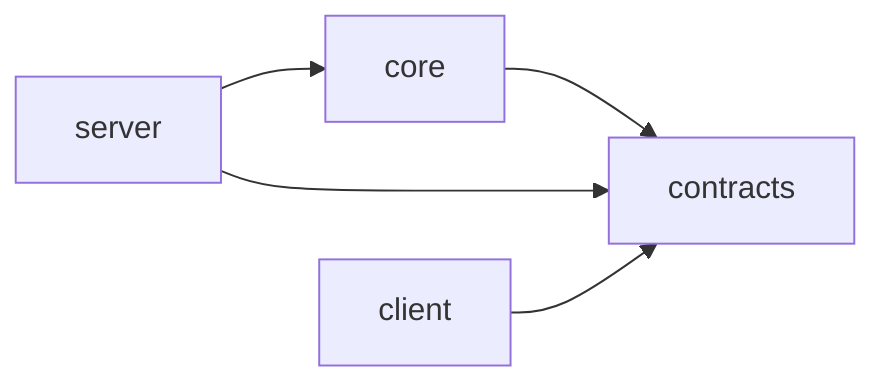
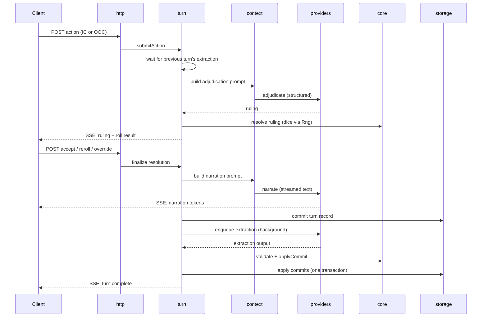

# Architecture

> **For Claude:** this document defines where code lives and what may depend on what.
> Module boundaries are enforced by lint; an import that violates this document is a
> build failure, not a style issue.

## 1. Repository layout

A pnpm workspace monorepo with two apps and two shared packages.

```
/apps
  /server            Fastify server: all game logic that touches IO
  /client            React + Vite browser client
/packages
  /contracts         Zod schemas and TypeScript types shared by everything
  /core              Pure game logic: dice, rules, state reducers, calendar math
/content-packs
  /reference         Reference content pack used by tests and first play
/content-library     Built-in reusable definitions (calendars, rulesets, slot schemas, tone profiles)
/spec                This specification
/scripts             Cross-platform Node scripts (no shell scripts)
```

- **ARCH-001** The repository MUST use pnpm workspaces, with the pnpm version pinned
  via the `packageManager` field.
- **ARCH-002** Node.js 26, version 26.11.0 or later (Active LTS from 2026-10-28), pinned
  via `.nvmrc` (`26`) and `engines` (`>=26.11.0 <27`). 26.11 is the first release with
  `node:sqlite`'s `Database` class (ADR-012).
- **ARCH-003** New top-level packages or apps MUST NOT be added without an ADR. Growth
  happens inside modules, not by multiplying packages.
- **ARCH-004** Workspace packages are named `@mythos/server`, `@mythos/client`,
  `@mythos/contracts`, and `@mythos/core`, and depend on each other with
  `workspace:*`. Imports across packages use these names, never relative paths.
  `@mythos/contracts` has a second entry point, `@mythos/contracts/content`, for the
  content schemas. `spec/reference` is also a workspace member (ADR-016).
- **ARCH-005** `contracts` and `core` have no build step: their `package.json`
  `exports` point at TypeScript source, and consumers compile it (Vite for the client,
  `tsx` for the server, Vitest for tests). `tsc --noEmit` typechecks each package
  (ADR-002, ADR-015).
- **ARCH-006** Root scripts: `pnpm dev` runs the server with `tsx watch` and the client
  with Vite's dev server, which proxies `/api`; `pnpm build` builds the client;
  `pnpm start` runs the server with `tsx`, serving the built client (ARCH-102);
  `pnpm check` is defined by CONV-122.
- **ARCH-007** `/scripts` holds repository tooling and imports no app code. Command-line
  tools that need server modules (rebuilding projections, recording fixtures) live in
  `apps/server/src/cli/` and run through the server package's scripts.

## 2. Packages and dependency direction



| Package | May depend on | Must never |
|---|---|---|
| `contracts` | `zod` only | Contain logic beyond schema definitions and trivial helpers |
| `core` | `contracts` | Perform IO, read the current time, use randomness directly, import Node or browser APIs |
| `server` | `core`, `contracts` | Be imported by anything |
| `client` | `contracts` | Import `core` or `server`; call model providers; hold game logic |

- **ARCH-010** `core` MUST be pure: every function is deterministic given its inputs.
  Randomness is passed in as an `Rng` and time as a `GameTime` or `WallTime` value.
- **ARCH-011** The client is a view. The engine is authoritative for every rule, roll,
  and state change. The client MAY compute display-only values (e.g. formatting).
- **ARCH-012** The client MUST NOT communicate with model or media providers. All model
  traffic goes through the server.

### 2.1 What lives in `core`

Pure logic that is easy to unit-test and has no reason to know about storage or models:

- Dice pool calculation, rolling (with injected `Rng`), result tiers, effect.
- Harm placement and overflow, resistance roll resolution.
- Clock arithmetic.
- World-state reducers: `applyCommit(state, commit) → state`.
- Commit validation against ruleset (legality checks that need no IO).
- Calendar conversion between game time and calendar dates.
- Retrieval scoring functions (given candidates and weights, rank them).
- Context budget allocation (given tier contents and token counts, fit them).

If a function needs a database, a file, a network call, or the current time, it does
not belong in `core`.

## 3. Server modules

The server is organized into modules under `apps/server/src/modules/`. Each module is
a folder with a single public entry point.

| Module | Responsibility |
|---|---|
| `config` | Load and validate machine config; resolve data directory |
| `storage` | SQLite connections, migrations, event log, projections, embedding storage |
| `content` | Load and validate content packs; snapshot into campaigns; render templates |
| `providers` | Model and media provider adapters; structured-output pipeline; job queue |
| `memory` | Observations, knowledge queries, entity wiki, relationships, retrieval, consolidation |
| `context` | Prompt assembly for each model role, using `core` budget allocation |
| `turn` | Turn pipeline orchestration, commit application, branches, rewrite and retcon |
| `world` | Game time advancement, time skips, world ticks, rumor propagation |
| `journal` | Player-scoped views of knowledge; notes and beliefs |
| `media` | Asset storage and versions; image and speech jobs (later phases) |
| `events` | SSE event bus and per-campaign replay buffer |
| `auth` | Optional PIN lock and session cookie |
| `http` | Fastify routes; maps HTTP to module calls; no game logic |

- **ARCH-020** Each module MUST expose its public API only through `index.ts`. Imports
  of another module's internal files are forbidden.
- **ARCH-021** Module dependencies MUST follow the table below. Anything not listed is
  forbidden. Cycles are forbidden.

| Module | May import |
|---|---|
| `config` | — |
| `storage` | `config` |
| `events` | — |
| `auth` | `config` |
| `content` | `config`, `storage` |
| `providers` | `config`, `storage`, `events` |
| `memory` | `storage`, `providers` |
| `context` | `content`, `memory`, `storage` |
| `journal` | `memory`, `storage` |
| `world` | `memory`, `context`, `providers`, `storage`, `events` |
| `turn` | `world`, `context`, `memory`, `providers`, `content`, `storage`, `events` |
| `media` | `providers`, `storage`, `content`, `events` |
| `http` | any module's public API |

- **ARCH-022** The **composition root** (`apps/server/src/app.ts`) is the only place
  modules are constructed and wired together. Modules receive their dependencies as
  explicit parameters. There is no DI container and no module-level singleton state.
  Command-line tools in `apps/server/src/cli/` (ARCH-007) get their modules from the
  composition root too, and import nothing else from the server.
- **ARCH-023** The `http` module MUST contain no game logic: validate the request with
  the contract schema, call one module function, map the result to a response.

## 4. Data and storage

### 4.1 Data directory

```
<dataDir>/
  machine-config.json
  content-packs/            user-installed packs (reference pack ships with the app)
  library/                  user-saved reusable definitions (04-content-schemas §2)
    workflows/              ComfyUI workflows and their mappings (MED §4)
  tls/                      self-signed certificate when HTTPS is on (MED-062)
  campaigns/
    <campaignId>/
      campaign.sqlite       everything about the campaign
      assets/               media files referenced by the database (later phases)
  logs/
```

- **ARCH-030** The data directory defaults to the OS-appropriate application data
  location (`%APPDATA%\Mythos` on Windows, `~/Library/Application Support/Mythos` on
  macOS) and is overridable in machine config and by command-line flag.
- **ARCH-031** A campaign is one folder. Copying the folder copies the campaign
  completely. Nothing about a campaign is stored outside its folder.
- **ARCH-032** Machine config is never written into a campaign or an export.

### 4.2 Event sourcing

All campaign history is an append-only **event log** of **commits**. A **projection**
is a derived table that can be rebuilt by replaying commits. The rest of the campaign
database is the content snapshot (ARCH-045) and the mutable state ARCH-040 names.

- **ARCH-040** Game state and its history MUST change only through commits, each
  belonging to exactly one turn, and only the commit application path writes
  projection tables. The deliberate exceptions are mutable state, not commits, because
  no game state derives from them:
  - branches and their heads, and the rest of TRN-002's state: `campaign_state`
    entries, such as the current branch (TRN-101), the content settings (CSET-020),
    and template overrides (CTX-005), plus resolution drafts and bookmarks;
  - caches: snapshots (ARCH-044) and suggested actions (TRN-059);
  - model call records (ARCH-061);
  - jobs (PRV-062);
  - assets (MED-010).
- **ARCH-041** A turn's commits MUST be applied in a single SQLite transaction: all or
  nothing.
- **ARCH-042** Projections MUST be rebuildable from the event log by a single command.
  This is tested.
- **ARCH-043** Every projection query MUST be scoped to a branch: results include only
  data produced by turns in the ancestry of the branch's head. (Mechanism is specified
  in `06-turn-engine.md`.)
- **ARCH-044** Snapshots of world state MAY be stored at intervals to speed up replay.
  Snapshots are caches; deleting them MUST NOT lose data.
- **ARCH-045** Canon (the content snapshot) is stored in the campaign database at
  creation and is read-only thereafter, except through an explicit "update from pack"
  operation that is itself recorded.

### 4.3 Schema versioning

- **ARCH-050** The campaign database uses numbered, forward-only SQL migrations run
  automatically on open. Migrations never delete commit data.
- **ARCH-051** Every JSON document (content files, machine config, commit payloads,
  exports) carries a `schemaVersion`. Loaders upgrade older versions in code or reject
  them with a clear message; they never guess.

### 4.4 Model call records

- **ARCH-060** Every model call made for a campaign MUST be recorded: role, provider, model, rendered prompt
  (by tier), token counts, raw output, parsed output, validation errors, retries,
  timing. These power the context inspector.
- **ARCH-061** Model call records are stored in the campaign database but are not
  commits; they are excluded from exports by default and subject to a retention setting.

## 5. The turn pipeline



- **ARCH-070** Only one turn per campaign is in flight at a time. A new action waits
  until the previous turn's extraction and world ticks have committed or failed
  (TIME-052).
- **ARCH-071** When a ruling requires no roll and the ruleset does not require
  confirmation, resolution completes without waiting for the client.
- **ARCH-072** Narration is never blocked on extraction of the same turn.

## 6. Runtime components

### 6.1 Job queue

All model and media work goes through one queue in the `providers` module.

- **ARCH-080** Jobs have a priority. From highest: `interactive` (adjudication,
  narration, NPC voice), `extraction`, `world-tick`, `consolidation`, `media`.
- **ARCH-081** Every provider endpoint is assigned a **device** in machine config. Jobs
  on the same device run one at a time (configurable concurrency, default 1). Jobs on
  different devices run in parallel.
- **ARCH-082** Background jobs (extraction and below) MUST be persisted so they survive
  a server restart and resume.
- **ARCH-083** Interactive jobs MUST be cancellable by the player.

### 6.2 Events to the client

- **ARCH-090** The server pushes all asynchronous updates over SSE, one stream per
  campaign a client has open. Clients send commands over HTTP POST.
- **ARCH-091** Every event has a monotonically increasing ID. On reconnect, the server
  replays missed events from a bounded buffer, or tells the client to refetch state if
  the buffer no longer covers the gap.
- **ARCH-092** Event types and payloads are defined as Zod schemas in `contracts`.

### 6.3 HTTP API

- **ARCH-100** All endpoints live under `/api`. Queries are `GET`; commands are `POST`,
  `PATCH`, or `DELETE`. Request and response bodies are defined in `contracts`.
- **ARCH-101** Errors return a consistent body: `{ error: { code, message, details? } }`
  with codes enumerated in `contracts`.
- **ARCH-102** The server serves the built client from `/` and the API from `/api` on
  one port. The client uses only relative URLs.
- **ARCH-103** Bind address and port come from machine config; default binds to all
  interfaces.
- **ARCH-104** Error codes map to HTTP statuses in one table in the `http` module:

| Status | Codes |
|---|---|
| 400 | `validation_failed` |
| 401 | `auth_required`, `auth_failed` |
| 404 | `not_found` |
| 409 | `conflict`, `turn_in_progress`, `cancelled` |
| 422 | `illegal_state_change`, `context_overflow` |
| 429 | `rate_limited` |
| 500 | `internal_error` |
| 502 | `model_output_invalid`, `provider_rejected` |
| 503 | `provider_unavailable`, `not_configured` |
| 504 | `provider_timeout` |

### 6.4 Auth

- **ARCH-110** When a PIN is configured, all `/api` routes except the session routes
  CON-113 lists (`GET` and `POST /session`) require a valid session cookie. The PIN is
  stored hashed. Failed attempts are rate-limited.
- **ARCH-111** Localhost MAY be exempted from the PIN by machine config.

## 7. Client architecture

```
apps/client/src/
  app/              routing, providers, layout shell
  features/<name>/  one folder per feature (play, journal, library, inspector, …)
  components/ui/    shadcn/ui components (generated, owned by the repo)
  components/       shared presentational components
  api/              typed API client and query hooks, built on contracts
  events/           SSE connection and cache updates
  stores/           Zustand stores for UI-only state
```

- **ARCH-120** Server state is held only in TanStack Query. SSE events update or
  invalidate the query cache; components never subscribe to SSE directly.
- **ARCH-121** Zustand stores hold UI state only (open panels, draft input, selected
  tab). They never hold copies of server data.
- **ARCH-122** Components never call `fetch`. They use hooks from `api/`.

## 8. Extension points reserved in phase 1

Per OVR-010, these exist from phase 1 even if unused:

- **ARCH-130** The `assets` folder and the `assets` and `asset_versions` tables in the
  campaign schema. Assets are campaign-level state, not a projection (MED-010).
- **ARCH-131** Device assignment and priority on every job.
- **ARCH-132** A `media` field on entity schemas and a `voiceProfile` field on character
  schemas (optional, validated, ignored until their phases).
- **ARCH-133** Provider adapters implement one common interface, `ProviderAdapter`
  (05-providers.md §3). Its optional members are the kinds an adapter serves (`text`,
  `embedding`, and later `image`, `speech-output`, `speech-input`), so a new kind is a
  new member and needs no queue changes.

## Traps

- **pnpm settings in `.npmrc` are ignored (ARCH-001).** pnpm 11 and later read only
  auth, registry, and network settings from `.npmrc`, and ignore the `pnpm` field in
  `package.json` for `onlyBuiltDependencies`. Every other setting, such as `engineStrict`
  and `allowBuilds`, goes in the root `pnpm-workspace.yaml`. A `pnpm-workspace.yaml` in a
  member folder makes that folder a workspace of its own.
- **A proxy on the host makes LAN requests look local (ARCH-111).** A reverse proxy on
  the same computer, or Vite's dev server proxying `/api`, connects to Mythos from
  loopback, so every request it forwards has a localhost socket address. A forwarding
  header is then the only sign that the request came from another device. Vite's proxy
  adds none by default, so P1-T21 sets `xfwd: true` on it; any other proxy must add
  `X-Forwarded-For` or `Forwarded`. Never decide localhost from `request.ip`, which
  follows Fastify's `trustProxy`.
- **`pnpm add` can quietly exempt a new release (ARCH-001, CONV-091).** pnpm 12 holds
  back versions published too recently (`minimumReleaseAge`). Asked for one by its exact
  version, it does not fail: it adds the version to `minimumReleaseAgeExclude` in
  `pnpm-workspace.yaml` and installs it. Check `git diff pnpm-workspace.yaml` after
  adding a dependency, and take the newest version old enough to pass instead.
- **Fastify sends a stream's headers with its first chunk (ARCH-091, http's
  `events.ts`).** A body that is a stream gets its status and headers through
  `setHeader`, which Node writes only when data does. An event stream that writes
  nothing at first sends nothing at all, and the browser's `EventSource` waits in its
  connecting state. `reply.hijack()` would send the headers at once, but it skips the
  `onSend` hook that sets the session cookie (Decisions).
- **A second signal kills the server mid-shutdown under `tsx watch` (ARCH-006,
  `scripts/dev.ts`).** Ctrl+C already reaches every process in the terminal. When
  `tsx watch` gets another signal while its child is still shutting down, it kills the
  child, and a narration being committed at shutdown is lost. `dev.ts` therefore sends
  nothing on Ctrl+C, and signals a child only when the other has ended by itself.

## Decisions

| Question | Decision | Rejected and why | Decided by |
|---|---|---|---|
| Which pnpm does the repository pin (ARCH-001)? | pnpm 12: `"packageManager": "pnpm@12.16.1"`. Dependency build scripts are approved in the root `pnpm-workspace.yaml` with `allowBuilds: { esbuild: true }`. | pnpm 10, which the handoff assumed: Corepack fetches pnpm 12, and pnpm 11 and later ignore the handoff's `pnpm.onlyBuiltDependencies` in `package.json`. | owner |
| Does `spec/reference` keep its own `pnpm-lock.yaml` now that it is a workspace member (ARCH-004)? | Yes. Inside the repository the root `pnpm-lock.yaml` governs it, and its own lockfile pins its versions when the folder is copied out and installed alone. | Deleting it: nothing in the repository reads it, but the standalone install would then resolve fresh versions. | owner |
| How is `packages/core/src/` organized (§2.1)? | In folders by governing spec document: `rules/` (07-rules, 11-gear), `state/` (06-turn-engine, 03-contracts §10), `knowledge/` (08-memory, 10-journal), `prompts/` (09-context, 13-content-settings), `time/` (12-time-world), and `media/` (15-media) from phase 9. `compare.ts`, `theme.ts`, and `index.ts` stay at the top. A folder has no `index.ts` of its own, so `src/index.ts` is the only entry point (CONV-015). | One flat folder: about 40 files by the end of phase 1. A folder per spec document: ten folders, several holding one or two files. | owner |
| Is the event stream per client session or per campaign (ARCH-090)? | Per campaign a client has open, as ARCH-090, UI-101, and the `GET /campaigns/:campaignId/events` route say. ADR-001's wording, "one stream per client session", is corrected to match. | Per client session: one stream for every campaign would contradict the route and UI-101, and each client would filter out other campaigns' events. | owner |
| Where does a new stream start (ARCH-091)? | With no `Last-Event-ID`, the route first writes `formatPosition(bus.lastId())`: an `id:` line and no `data:`, which sets the browser's last event ID without firing an event. A client that drops before its first event then reconnects with a covered ID and misses nothing. | Starting with nothing: a client that drops before its first event reconnects with no `Last-Event-ID` and silently misses whatever was published while it was away. Sending `resync.required` on every first connect: the client has only just fetched. | owner |
| How do event IDs and replay coverage work (ARCH-091)? | One ID counter for the whole process, starting at `firstId`, so a campaign's IDs can skip numbers. Each campaign's buffer remembers `lastDroppedId`, the last ID it evicted (`firstId - 1` at first); a `Last-Event-ID` is covered when `lastDroppedId <= id <= lastId()`, since the buffer holds every event of the campaign after `lastDroppedId`. `resync.required` takes an ID of its own and is not buffered. | Coverage by the oldest buffered ID: other campaigns' IDs fall in the gaps, so a client that missed nothing would be told to resync. A counter per campaign: `lastId()` would need a campaign, and the contract numbers IDs per process. Buffering `resync.required`: a later replay would make another client refetch for nothing. Giving it no ID: the client's last ID would stay uncovered, and every reconnect would resync again. | Claude (ruling) |
| What happens to sessions when the PIN is set, changed, or removed (ARCH-110)? | Every session ends, so a lost phone can be signed out without a restart. The device that made the change logs in again, unless it is an exempt localhost. | Keeping sessions: a device that knew the old PIN would stay signed in until it went 30 days unused or the server restarted. | owner |
| Who may use the server when machine config fails to load (ARCH-110, ARCH-111)? | Localhost only, with no forwarding header, as ARCH-111's Decisions row defines it; `localhostExempt` is unknown, so it is not consulted. Every other device is refused with `auth_required`, so the owner fixes the config in Settings on the host. | Letting every device in: a broken file would turn the lock off for the whole network. Refusing every device: the owner could not reach Settings to fix it. | owner |
| What counts as localhost (ARCH-111)? | A socket address of `127.0.0.1`, `::1`, or `::ffff:127.0.0.1` (IPv4 loopback on a dual-stack socket), with no `X-Forwarded-For` and no `Forwarded` header, whatever their value. Other `127.x.x.x` addresses are not localhost. | `request.ip` or a `Host` of `localhost`: the client controls the `Host` header, and `request.ip` follows `trustProxy`. All of `127.0.0.0/8`: nothing Mythos expects connects from the rest of it, and a narrow rule is easier to check. | Claude (ruling) |
| What does the PIN gate read from a request (ARCH-110, CON-113)? | The socket's address (`request.socket.remoteAddress`), the headers, the session cookie, the method, and the matched route pattern (`request.routeOptions.url`). A pattern outside `/api` passes, and so does a request no route matched, which reaches only the not-found handler: the client's `index.html`, or `not_found`. | The raw URL: a test on it can disagree with the router about which route runs, through query strings, duplicate slashes, or encodings. | Claude (ruling) |
| What may change campaign data without a commit (ARCH-040)? | Only the exceptions ARCH-040 names: branches and the rest of TRN-002's state (the `campaign_state` entries, resolution drafts, and bookmarks), caches, model call records, jobs, and assets. Everything game state derives from is a commit. | Every change as a commit, as ARCH-040 first said: TRN-002, CSET-020, CTX-005, ARCH-061, PRV-062, and MED-010 each already say their data is not commits, and a branch pointer or a job update would need a turn to belong to. | owner |
| How many transactions does one storage write use (ARCH-041, TRN-123)? | One: each public storage function is one transaction. A command that needs several writes at once gets a dedicated storage function that makes them together, as `insertRootTurn` writes the root turn, its sets, and the first branch. | Exporting `transaction` for callers to wrap several storage calls: SQL concerns would spread into the modules that compose them, and nested calls would need savepoints. | owner |
| How is the content snapshot stored (ARCH-045, SCH-111)? | In two tables. `canon` has one row per definition, entity, or file: its `kind`, `id`, JSON (parsed on read with the kind's content schema), and Markdown. The kinds are `setting`, `calendar`, `slots`, `tone`, `ruleset`, `scenario`, `theme`, `entity` (runtime form, SCH-005), `history`, and `relationships`. `canon_templates` has the template files by layer and path (CTX-005). The theme is snapshotted because a copied campaign cannot rely on the library (ARCH-031). | One table for both: a template has a layer and a path where an entry has a kind and an ID. A SQL `CHECK` on `kind`: a new kind would need a table rebuild. | Claude (ruling) |
| How is a model call record's time stored (ARCH-061)? | `model_calls.created_at` is INTEGER milliseconds since 1970 UTC, so the retention prune compares numbers; the record's JSON keeps its `createdAt` string. | A WallTime string: strings with different numbers of fraction digits sort wrongly (02-conventions Traps). | Claude (ruling) |
| Does the client's dev server mark the requests it proxies as forwarded (ARCH-006, ARCH-111)? | Yes: Vite's `/api` proxy sets `xfwd: true`, so each request carries `X-Forwarded-For`, and the PIN lock never exempts a forwarded request as localhost. A LAN device using the dev server needs the PIN, as it would with `pnpm start`; so does the host machine itself in development, when a PIN is set. | No `xfwd`: every request through the dev server would reach the server from 127.0.0.1, and the localhost exemption would let any LAN device in without the PIN. | Claude (ruling) |
| What does campaign creation write together (TRN-123, ARCH-041)? | `createCampaignFolder` makes the folder and writes the `campaign` row; then `writeCampaignStart` writes canon, the first `content_settings` and `current_branch_id`, and the root turn with its setup set and branch `Main`, in one transaction. If either step throws, campaign creation deletes the folder and rethrows. Every expected failure is found before the folder is made. | Writing the `campaign` row in the same transaction: `createCampaignFolder` writes it, and moving it would change storage's API for a gap the Open section records. A transaction per part: a crash could leave canon with no root turn. | Claude (ruling) |
| What does a request no route or file matched get (ARCH-102, CON-110)? | Under `/api`, `not_found`. Outside it, a GET or HEAD whose last path segment has no dot gets the client's `index.html`, so the client's router opens the screen its URL names. Anything else, such as a missing `/assets/x.js` or a POST, is `not_found`. With no built client, every page is `not_found`, saying to run `pnpm build`. | `index.html` for every GET outside `/api`: a missing script would come back as HTML, which the browser reports as a MIME error, not a 404. Deciding by the `Accept` header: a browser's navigations and its fetches send different values, and tools send none. | Claude (ruling) |
| What happens to a client that falls behind its event stream (ARCH-090)? | Its stream is closed, with a warning, once more than 1 MiB (`MAX_UNSENT_BYTES` in http's `events.ts`) it has not taken waits in the stream and the socket. Its `EventSource` reconnects with its last event ID and is replayed from the bus, or told to resync, so nothing is lost. | No limit: Node's socket buffer grows without bound. Dropping events for that client: it could not tell what it missed. | Claude (ruling) |
| What does a stream with nothing to send at first write (ARCH-091)? | When neither the position frame nor a replay wrote anything, the keep-alive comment goes at once, so the headers are sent and the browser's `open` fires (Traps). | Waiting 15 seconds for the first keep-alive: the client could not tell a live stream from a stalled one. Writing the position frame on every connect: after a `Last-Event-ID`, a drop during the replay would leave the browser at the newest ID, and the rest of the replay would be lost. | Claude (ruling) |
| How does the server shut down (ARCH-022, ARCH-083)? | `close()`: Fastify refuses new requests with 503. A `preClose` hook ends every event stream, then runs `narrations.stop()`, then the queue's `stop()`, which cancels interactive jobs, so a pending probe returns. In-flight requests finish, and an `onClose` hook closes every database. `main.ts` calls `close()` on SIGINT or SIGTERM, and exits at once on a second signal. | Closing the databases in `preClose`: a request still in flight would find its connection closed. Stopping the queue first: partial narration would not be committed (06-turn-engine Decisions). | Claude (ruling) |
| Where do the server's logs go (§4.1)? | Pino's JSON on stdout only, in phase 1. `<dataDir>/logs/` stays empty until a task defines what goes there (Open). | A file in `logs/` through Fastify's logger option: with no rotation or retention, it would grow without limit. | owner |

## Open

- **Replay buffers are never freed (ARCH-091).** Each campaign's buffer, up to 1,000
  events, stays in memory until the server restarts, including after the campaign is
  deleted.
- **IDs after a restart assume a modest event rate (ARCH-091).** The first ID is the
  server's start time in milliseconds, so a new ID is larger than any the previous
  process issued only if that process averaged fewer than one event per millisecond.
- **An open event stream outlives its session (ARCH-110, CON-113).** The gate checks
  the session when the stream connects. After a logout, a PIN change, or the session's
  expiry, a stream that is already open keeps sending events until it closes; its next
  reconnect is refused.
- **A newer campaign database has no error code (ARCH-050, CON-090).** A campaign last
  opened by a newer Mythos is refused with an exception whose message says to update
  Mythos. No `ErrorCode` fits, so the HTTP layer reports it as `internal_error`. If the
  library should show that message as it is, the error needs a code of its own.
- **A crash between the campaign row and the campaign start (ARCH-031, TRN-123).** A new
  campaign's `campaign` row is written before the transaction that writes its canon and
  root turn. If the process dies between the two, the folder holds a campaign with no
  canon or root turn, and `campaignView` and `listCampaignSummaries` throw on it, so the
  whole campaign list fails until the folder is deleted by hand. A fix would write the
  row in `writeCampaignStart`'s transaction, or have the list skip and report such a
  campaign.
- **`<dataDir>/logs/` is unused (§4.1).** Logs go to stdout (Decisions). A later task
  decides whether the server also writes them there, and how they are rotated and kept.
- **The session cookie is never `Secure` yet (ARCH-110, MED-062).** The composition root
  passes `secureCookies: false`, because the server speaks only HTTP until phase 10
  brings HTTPS. That phase passes whether the running server started with HTTPS.
