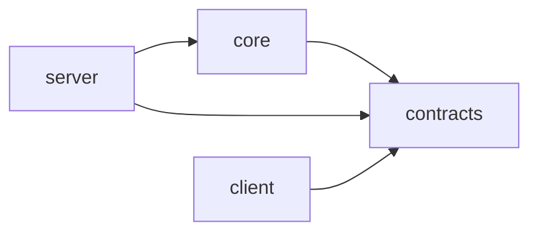
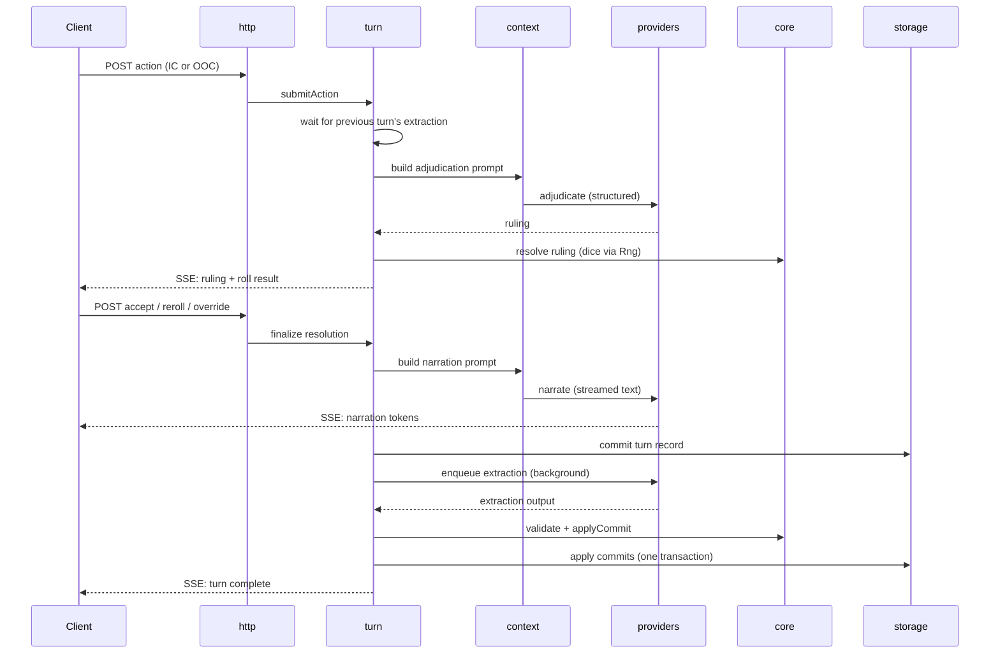

# Architecture

> **For Claude:** this document defines where code lives and what may depend on what.
> Module boundaries are enforced by lint; an import that violates this document is a
> build failure, not a style issue.

## 1. Repository layout

A pnpm workspace monorepo with two apps and two shared packages.

```
/apps
  /server            Fastify server: all game logic that touches IO
  /client            React + Vite browser client
/packages
  /contracts         Zod schemas and TypeScript types shared by everything
  /core              Pure game logic: dice, rules, state reducers, calendar math
/content-packs
  /reference         Reference content pack used by tests and first play
/content-library     Built-in reusable definitions (calendars, rulesets, slot schemas, tone profiles)
/spec                This specification
/scripts             Cross-platform Node scripts (no shell scripts)
```

- **ARCH-001** The repository MUST use pnpm workspaces, with the pnpm version pinned
  via the `packageManager` field.
- **ARCH-002** Node.js 26, version 26.11.0 or later (Active LTS from 2026-10-28), pinned
  via `.nvmrc` (`26`) and `engines` (`>=26.11.0 <27`). 26.11 is the first release with
  `node:sqlite`'s `Database` class (ADR-012).
- **ARCH-003** New top-level packages or apps MUST NOT be added without an ADR. Growth
  happens inside modules, not by multiplying packages.
- **ARCH-004** Workspace packages are named `@mythos/server`, `@mythos/client`,
  `@mythos/contracts`, and `@mythos/core`, and depend on each other with
  `workspace:*`. Imports across packages use these names, never relative paths.
  `@mythos/contracts` has a second entry point, `@mythos/contracts/content`, for the
  content schemas. `spec/reference` is also a workspace member (ADR-016).
- **ARCH-005** `contracts` and `core` have no build step: their `package.json`
  `exports` point at TypeScript source, and consumers compile it (Vite for the client,
  `tsx` for the server, Vitest for tests). `tsc --noEmit` typechecks each package
  (ADR-002, ADR-015).
- **ARCH-006** Root scripts: `pnpm dev` runs the server with `tsx watch` and the client
  with Vite's dev server, which proxies `/api`; `pnpm build` builds the client;
  `pnpm start` runs the server with `tsx`, serving the built client (ARCH-102);
  `pnpm check` is defined by CONV-122.
- **ARCH-007** `/scripts` holds repository tooling and imports no app code. Command-line
  tools that need server modules (rebuilding projections, recording fixtures) live in
  `apps/server/src/cli/` and run through the server package's scripts.

## 2. Packages and dependency direction



| Package | May depend on | Must never |
|---|---|---|
| `contracts` | `zod` only | Contain logic beyond schema definitions and trivial helpers |
| `core` | `contracts` | Perform IO, read the clock, use randomness directly, import Node or browser APIs |
| `server` | `core`, `contracts` | Be imported by anything |
| `client` | `contracts` | Import `core` or `server`; call model providers; hold game logic |

- **ARCH-010** `core` MUST be pure: every function is deterministic given its inputs.
  Randomness is passed in as an `Rng` and time as a `GameTime` or clock parameter.
- **ARCH-011** The client is a view. The engine is authoritative for every rule, roll,
  and state change. The client MAY compute display-only values (e.g. formatting).
- **ARCH-012** The client MUST NOT communicate with model or media providers. All model
  traffic goes through the server.

### 2.1 What lives in `core`

Pure logic that is easy to unit-test and has no reason to know about storage or models:

- Dice pool calculation, rolling (with injected `Rng`), result tiers, effect.
- Harm placement and overflow, resistance roll resolution.
- Clock arithmetic.
- World-state reducers: `applyCommit(state, commit) → state`.
- Commit validation against ruleset (legality checks that need no IO).
- Calendar conversion between game time and calendar dates.
- Retrieval scoring functions (given candidates and weights, rank them).
- Context budget allocation (given tier contents and token counts, fit them).

If a function needs a database, a file, a network call, or the current time, it does
not belong in `core`.

## 3. Server modules

The server is organized into modules under `apps/server/src/modules/`. Each module is
a folder with a single public entry point.

| Module | Responsibility |
|---|---|
| `config` | Load and validate machine config; resolve data directory |
| `storage` | SQLite connections, migrations, event log, projections, embedding storage |
| `content` | Load and validate content packs; snapshot into campaigns; render templates |
| `providers` | Model and media provider adapters; structured-output pipeline; job queue |
| `memory` | Observations, knowledge queries, entity wiki, relationships, retrieval, consolidation |
| `context` | Prompt assembly for each model role, using `core` budget allocation |
| `turn` | Turn pipeline orchestration, commit application, branches, rewrite and retcon |
| `world` | Game time advancement, time skips, world ticks, rumor propagation |
| `journal` | Player-scoped views of knowledge; notes and beliefs |
| `media` | Asset storage and versions; image and speech jobs (later phases) |
| `events` | SSE event bus and per-session replay buffer |
| `auth` | Optional PIN lock and session cookie |
| `http` | Fastify routes; maps HTTP to module calls; no game logic |

- **ARCH-020** Each module MUST expose its public API only through `index.ts`. Imports
  of another module's internal files are forbidden.
- **ARCH-021** Module dependencies MUST follow the table below. Anything not listed is
  forbidden. Cycles are forbidden.

| Module | May import |
|---|---|
| `config` | — |
| `storage` | `config` |
| `events` | — |
| `auth` | `config` |
| `content` | `config`, `storage` |
| `providers` | `config`, `storage`, `events` |
| `memory` | `storage`, `providers` |
| `context` | `content`, `memory`, `storage` |
| `journal` | `memory`, `storage` |
| `world` | `memory`, `context`, `providers`, `storage`, `events` |
| `turn` | `world`, `context`, `memory`, `providers`, `content`, `storage`, `events` |
| `media` | `providers`, `storage`, `content`, `events` |
| `http` | any module's public API |

- **ARCH-022** The **composition root** (`apps/server/src/app.ts`) is the only place
  modules are constructed and wired together. Modules receive their dependencies as
  explicit parameters. There is no DI container and no module-level singleton state.
  Command-line tools in `apps/server/src/cli/` (ARCH-007) get their modules from the
  composition root too, and import nothing else from the server.
- **ARCH-023** The `http` module MUST contain no game logic: validate the request with
  the contract schema, call one module function, map the result to a response.

## 4. Data and storage

### 4.1 Data directory

```
<dataDir>/
  machine-config.json
  content-packs/            user-installed packs (reference pack ships with the app)
  library/                  user-saved reusable definitions (04-content-schemas §2)
    workflows/              ComfyUI workflows and their mappings (MED §4)
  tls/                      self-signed certificate when HTTPS is on (MED-062)
  campaigns/
    <campaignId>/
      campaign.sqlite       everything about the campaign
      assets/               media files referenced by the database (later phases)
  logs/
```

- **ARCH-030** The data directory defaults to the OS-appropriate application data
  location (`%APPDATA%\Mythos` on Windows, `~/Library/Application Support/Mythos` on
  macOS) and is overridable in machine config and by command-line flag.
- **ARCH-031** A campaign is one folder. Copying the folder copies the campaign
  completely. Nothing about a campaign is stored outside its folder.
- **ARCH-032** Machine config is never written into a campaign or an export.

### 4.2 Event sourcing

All campaign history is an append-only **event log** of **commits**. Everything else
in the campaign database is a **projection**: a derived table that can be rebuilt by
replaying commits.

- **ARCH-040** Every change to campaign data MUST be expressed as a commit belonging to
  exactly one turn. There are no direct writes to projection tables outside the commit
  application path.
- **ARCH-041** A turn's commits MUST be applied in a single SQLite transaction: all or
  nothing.
- **ARCH-042** Projections MUST be rebuildable from the event log by a single command.
  This is tested.
- **ARCH-043** Every projection query MUST be scoped to a branch: results include only
  data produced by turns in the ancestry of the branch's head. (Mechanism is specified
  in `06-turn-engine.md`.)
- **ARCH-044** Snapshots of world state MAY be stored at intervals to speed up replay.
  Snapshots are caches; deleting them MUST NOT lose data.
- **ARCH-045** Canon (the content snapshot) is stored in the campaign database at
  creation and is read-only thereafter, except through an explicit "update from pack"
  operation that is itself recorded.

### 4.3 Schema versioning

- **ARCH-050** The campaign database uses numbered, forward-only SQL migrations run
  automatically on open. Migrations never delete commit data.
- **ARCH-051** Every JSON document (content files, machine config, commit payloads,
  exports) carries a `schemaVersion`. Loaders upgrade older versions in code or reject
  them with a clear message; they never guess.

### 4.4 Model call records

- **ARCH-060** Every model call made for a campaign MUST be recorded: role, provider, model, rendered prompt
  (by tier), token counts, raw output, parsed output, validation errors, retries,
  timing. These power the context inspector.
- **ARCH-061** Model call records are stored in the campaign database but are not
  commits; they are excluded from exports by default and subject to a retention setting.

## 5. The turn pipeline



- **ARCH-070** Only one turn per campaign is in flight at a time. A new action waits
  until the previous turn's extraction and world ticks have committed or failed
  (TIME-052).
- **ARCH-071** When a ruling requires no roll and the ruleset does not require
  confirmation, resolution completes without waiting for the client.
- **ARCH-072** Narration is never blocked on extraction of the same turn.

## 6. Runtime components

### 6.1 Job queue

All model and media work goes through one queue in the `providers` module.

- **ARCH-080** Jobs have a priority. From highest: `interactive` (adjudication,
  narration, NPC voice), `extraction`, `world-tick`, `consolidation`, `media`.
- **ARCH-081** Every provider endpoint is assigned a **device** in machine config. Jobs
  on the same device run one at a time (configurable concurrency, default 1). Jobs on
  different devices run in parallel.
- **ARCH-082** Background jobs (extraction and below) MUST be persisted so they survive
  a server restart and resume.
- **ARCH-083** Interactive jobs MUST be cancellable by the player.

### 6.2 Events to the client

- **ARCH-090** The server pushes all asynchronous updates over SSE, one stream per
  campaign a client has open. Clients send commands over HTTP POST.
- **ARCH-091** Every event has a monotonically increasing ID. On reconnect, the server
  replays missed events from a bounded buffer, or tells the client to refetch state if
  the buffer no longer covers the gap.
- **ARCH-092** Event types and payloads are defined as Zod schemas in `contracts`.

### 6.3 HTTP API

- **ARCH-100** All endpoints live under `/api`. Queries are `GET`; commands are `POST`,
  `PATCH`, or `DELETE`. Request and response bodies are defined in `contracts`.
- **ARCH-101** Errors return a consistent body: `{ error: { code, message, details? } }`
  with codes enumerated in `contracts`.
- **ARCH-102** The server serves the built client from `/` and the API from `/api` on
  one port. The client uses only relative URLs.
- **ARCH-103** Bind address and port come from machine config; default binds to all
  interfaces.
- **ARCH-104** Error codes map to HTTP statuses in one table in the `http` module:

| Status | Codes |
|---|---|
| 400 | `validation_failed` |
| 401 | `auth_required`, `auth_failed` |
| 404 | `not_found` |
| 409 | `conflict`, `turn_in_progress`, `cancelled` |
| 422 | `illegal_state_change`, `context_overflow` |
| 429 | `rate_limited` |
| 500 | `internal_error` |
| 502 | `model_output_invalid`, `provider_rejected` |
| 503 | `provider_unavailable`, `not_configured` |
| 504 | `provider_timeout` |

### 6.4 Auth

- **ARCH-110** When a PIN is configured, all `/api` routes except the PIN check require
  a valid session cookie. The PIN is stored hashed. Failed attempts are rate-limited.
- **ARCH-111** Localhost MAY be exempted from the PIN by machine config.

## 7. Client architecture

```
apps/client/src/
  app/              routing, providers, layout shell
  features/<name>/  one folder per feature (play, journal, library, inspector, …)
  components/ui/    shadcn/ui components (generated, owned by the repo)
  components/       shared presentational components
  api/              typed API client and query hooks, built on contracts
  events/           SSE connection and cache updates
  stores/           Zustand stores for UI-only state
```

- **ARCH-120** Server state is held only in TanStack Query. SSE events update or
  invalidate the query cache; components never subscribe to SSE directly.
- **ARCH-121** Zustand stores hold UI state only (open panels, draft input, selected
  tab). They never hold copies of server data.
- **ARCH-122** Components never call `fetch`. They use hooks from `api/`.

## 8. Extension points reserved in phase 1

Per OVR-010, these exist from phase 1 even if unused:

- **ARCH-130** The `assets` folder and an `assets` projection in the campaign schema.
- **ARCH-131** Device assignment and priority on every job.
- **ARCH-132** A `media` field on entity schemas and a `voiceProfile` field on character
  schemas (optional, validated, ignored until their phases).
- **ARCH-133** Provider adapters implement a common interface with a `kind`
  (`text`, `embedding`, `image`, `speech-output`, `speech-input`) so new kinds need no
  queue changes.

## Traps

- **pnpm settings in `.npmrc` are ignored (ARCH-001).** pnpm 11 and later read only
  auth, registry, and network settings from `.npmrc`, and ignore the `pnpm` field in
  `package.json` for `onlyBuiltDependencies`. Every other setting, such as `engineStrict`
  and `allowBuilds`, goes in the root `pnpm-workspace.yaml`. A `pnpm-workspace.yaml` in a
  member folder makes that folder a workspace of its own.

## Decisions

| Question | Decision | Rejected and why | Decided by |
|---|---|---|---|
| Which pnpm does the repository pin (ARCH-001)? | pnpm 12: `"packageManager": "pnpm@12.16.1"`. Dependency build scripts are approved in the root `pnpm-workspace.yaml` with `allowBuilds: { esbuild: true }`. | pnpm 10, which the handoff assumed: Corepack fetches pnpm 12, and pnpm 11 and later ignore the handoff's `pnpm.onlyBuiltDependencies` in `package.json`. | owner |
| Does `spec/reference` keep its own `pnpm-lock.yaml` now that it is a workspace member (ARCH-004)? | Yes. Inside the repository the root `pnpm-lock.yaml` governs it, and its own lockfile pins its versions when the folder is copied out and installed alone. | Deleting it: nothing in the repository reads it, but the standalone install would then resolve fresh versions. | owner |
