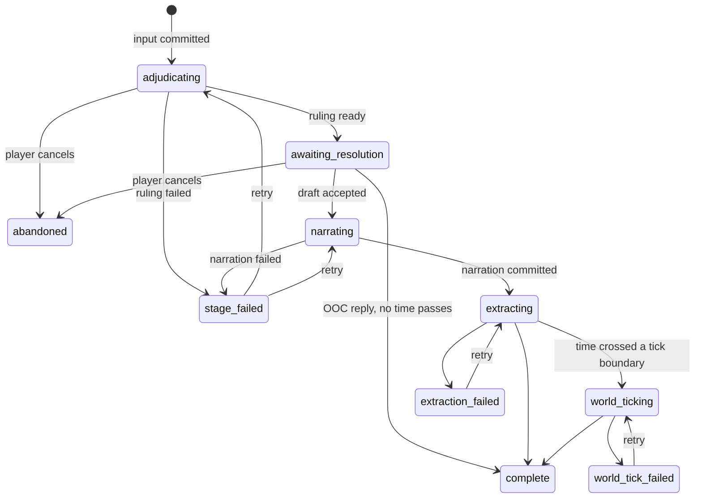

# Turn Engine

> **For Claude:** read `03-contracts.md` §8 and §10 first. The code block in §12 is
> **normative** and belongs in `packages/contracts/src/turn-api.ts`. This document
> owns the `turn` server module and the pure turn logic in `packages/core`.

This document defines how a turn runs, how every part of it can be edited or
regenerated, how branches work, and how any query is scoped to a branch. Rules
mechanics (dice math, consequences, harm) are in `07-rules.md`; what goes into each
prompt is in `09-context.md`; extraction output is in `08-memory.md`.

## 1. Mental model

Campaign history is a **tree of turns**. A **branch** is a named pointer to one turn,
its **head**; the branch's history is the head's **ancestry** (the path back to the
root). Everything a turn contains, from the player's input to the memories extracted
from it, is stored as **commit sets**, one per stage.

```
                         ┌─ 21 ─ 22 ─ 23          branch "Sided with the Wardens" (head 23)
 0 ─ 1 ─ … ─ 19 ─ 20 ────┤
                         └─ 21'─ 22'─ … ─ 40      branch "Main" (head 40)
```

Turns 0–20 are shared. Nothing is ever edited in place on a shared turn
(copy-on-write, §8.3), so each branch is an independent timeline.

Within a turn, editing never deletes. A new set **supersedes** the old one, which stays
in the log as an older version. Each set records the upstream sets it was **based on**;
when any of those is superseded, the set becomes **stale**.

```
input ──▶ adjudication ──▶ resolution ──▶ narration ──▶ extraction
  (each arrow: "is based on"; superseding a set stales everything to its right)
```

## 2. Storage

Tables owned by the `turn` module, in the campaign database. Projections owned by
other modules (observations, grants, and so on) follow the scoping rules in §6.

| Table | Kind | Purpose |
|---|---|---|
| `turns` | log | One row per turn (`Turn` schema). |
| `commit_sets` | log | One row per set (`CommitSet` schema) plus a denormalized `active` flag. |
| `commits` | log | One row per commit, payload as JSON. |
| `branches` | state | One row per branch (`Branch` schema). Mutable pointers. |
| `branch_turns` | projection | `(branch_id, turn_id, depth)` for every turn in each branch's ancestry. |
| `campaign_state` | state | `current_branch_id` and other per-campaign UI state shared by all devices. |
| `resolution_drafts` | state | The pending `ResolutionDraft` per turn while awaiting resolution. |
| `turn_suggestions` | cache | Suggested actions per turn (§5.8). |
| `snapshots` | cache | Folded state at a turn (§6.3). |
| `replay_conflicts` | projection | Commits skipped during replay (§6.4). |
| `bookmarks` | state | `Bookmark` rows. |

- **TRN-001** `turns`, `commit_sets`, and `commits` are append-only (CON-080). The only
  mutable column among them is `turns.status`, and `commit_sets.active`, which is
  derived from supersession and kept in sync in the same transaction.
- **TRN-002** `branches`, `campaign_state`, `resolution_drafts`, and `bookmarks` are
  ordinary mutable state, not part of the event log. Changing a branch pointer is not a
  commit.
- **TRN-003** `branch_turns` is maintained incrementally: inserting a turn adds one row;
  fork, rewind, and copy-on-write rewrite the affected depth range. It is rebuildable
  from `turns` and `branches` (ARCH-042).

## 3. Turn lifecycle



- **TRN-010** A turn's status reflects pipeline progress only. Staleness, versions,
  and conflicts are derived separately and shown alongside it.
- **TRN-011** When an action is submitted, a new turn is inserted as a child of the
  branch head, the input set is committed, and the branch head moves to the new turn,
  all in one transaction. The input is therefore never lost to a crash.
- **TRN-012** On server start, turns left in `adjudicating` or `narrating` are moved
  to `stage-failed` (interactive jobs are not persisted, PRV-061). Turns in
  `extracting` or `world-ticking` resume through their persisted jobs.

## 4. Pipeline by input mode

| Input | Adjudication | Resolution | Narration | Extraction |
|---|---|---|---|---|
| In-character | always | always | always | always |
| OOC, `elapsedMinutes` = 0 | always (returns `ooc` ruling) | records the reply only | skipped | skipped |
| OOC, `elapsedMinutes` > 0 | always (or built by the engine, TIME-040) | advances time | transition narration | always, then world ticks |
| Turn zero | — | — (uses `setup`) | opening narration | always |

- **TRN-020** Pure OOC exchanges (questions, clarifications) change nothing in the
  fiction. The reply is the turn's output. They appear in the transcript but are
  excluded from narration context after a few turns (09-context).
- **TRN-021** The player corrects a past turn by editing it (§7), not by OOC message.
  An OOC message such as "Varek wouldn't do that" gets an OOC reply, and the UI offers
  the edit controls for the turn it refers to.

## 5. Stages

### 5.1 Input

- **TRN-030** The input set contains one `input.set` commit. Its origin is `player`.

### 5.2 Adjudication

- **TRN-031** The adjudicator receives context as of the **parent** turn plus this
  turn's input (09-context) and returns a `Ruling` through `callStructured` (PRV-050),
  with the semantic checks CON-030 to CON-032.
- **TRN-032** The ruling decides `elapsedMinutes` for the action. Adjudication is the
  only source of game-time advance during play; extraction never advances time.
- **TRN-033** The ruling's stakes and consequence descriptions are shown to the player
  before any roll, so they MUST be written without hidden information. Like CON-033,
  this is enforced by the adjudication template and reviewable in the inspector.
- **TRN-034** If adjudication fails (`model_output_invalid`, `provider_rejected`, or
  exhausted retries), the turn moves to `stage-failed` and the player chooses: retry,
  retry with another model, write the ruling manually (the ruling form), or edit the
  input. There is no automatic fallback ruling.

### 5.3 Resolution

Resolution is the only interactive stage. It turns a ruling into a **resolution draft**,
lets the player adjust it, and commits it.

- **TRN-040** Building the draft is pure `core` logic given the ruling, the world state
  as of the parent, the ruleset, and an `Rng`:
  - `roll` ruling: roll the action, select the outcome, scale it by effect, and run
    each harm through armor, resistance, and placement (`07-rules.md` §5).
  - `direct` ruling: outcome and effect come from the ruling; no action roll;
    resistance rolls as above.
  - `ooc` ruling: no roll, no consequences.
- **TRN-041** The draft is stored in `resolution_drafts` and sent in a
  `resolution.ready` event. A restart restores the same draft; it never rerolls.
- **TRN-042** Draft actions (`ResolveCommand`): `accept`, `reroll-action`,
  `reroll-resistance`, `set-outcome`, `edit-consequences`, `cancel`. Every action other
  than `accept` and `cancel` sets `overridden`. Overrides are always free.
- **TRN-043** `requiresResponse` is false, and the draft is accepted immediately, when
  the ruling is `ooc`; or `direct` and the ruleset has `confirmDirectRulings: false`;
  or `roll` and the ruleset has `confirmRolls: false`. The draft card is still shown
  and its result can be changed later by editing the resolution stage.
- **TRN-044** Accepting writes the resolution set: clocks, rolls, the
  `resolution.record`, harm and treatment, deaths, clock ticks and stat changes,
  `time.advance` when `elapsedMinutes` > 0, healing, and `override.record` commits when
  overridden, in the order given by RUL-072. The set's origin
  is `player` if the draft was overridden, otherwise `engine`. The set is semantically
  validated before it is applied (strict on write, §6.4).
- **TRN-045** If the resolution set fails validation (for example, a consequence
  targets a character who died earlier this turn), the failing consequences are listed
  in the draft and the player edits or removes them before accepting again.
- **TRN-046** A time advance that crosses world-tick boundaries schedules world ticks,
  which run after the turn's extraction (TIME-051). The next action waits for them
  (TIME-052).
- **TRN-047** `cancel` (or cancelling during adjudication) moves the branch head back
  to the parent, marks the turn `abandoned`, and returns the input text to the client
  so the player can edit and resubmit. Abandoned turns are unreachable but not deleted.

### 5.4 Narration

- **TRN-050** The narrator receives context as of the parent turn plus this turn's
  input, ruling, and applied resolution (so new harm is visible), and streams plain
  text (PRV-045). The narrator describes the resolved outcome and never decides
  mechanics.
- **TRN-051** The narration set holds one `narration.set`. If the player cancels or
  generation stops early (`finishReason` `length` or `cancelled`), the partial text is
  committed with `complete: false`, and extraction still runs on it.
- **TRN-052** If narration fails before producing text, the turn moves to
  `stage-failed`: retry, retry with another model, or write the narration manually.
  If it fails after producing text, that text is committed with `complete: false`, as
  if the player had stopped it (TRN-149), and the error is shown with the turn.
- **TRN-053** NPC voice sub-calls, when enabled, happen inside this stage. The turn
  engine sees one narration result (09-context).
- **TRN-149** While narration streams, `cancel` (`POST /turns/:turnId/cancel`) stops
  it (PRV-047): the partial text is committed with `complete: false` (TRN-051) and the
  turn carries on as if narration had finished. The turn is not abandoned. If no text
  has arrived yet, there is nothing to keep, so `cancel` abandons the turn as TRN-047
  does and returns the input for editing; turn zero, which has no input, becomes
  `stage-failed` instead.
- **TRN-150** While narration streams, `GET /turns/:turnId` returns the text streamed
  so far with `complete: false`, so a client that opens the campaign mid-stream shows
  it and then applies further deltas by offset (UI-101).

### 5.5 Extraction

- **TRN-054** After the narration set commits, an `extraction` job is enqueued
  (persisted, ARCH-082). Its output is converted to commits and validated (08-memory);
  the set is applied atomically, or the turn moves to `extraction-failed`.
- **TRN-055** `extraction-failed` does not block play: the next action proceeds
  (ARCH-070), the turn shows a badge, and the player can retry, retry with another
  model, or add memories by hand.

### 5.6 Turn zero

- **TRN-056** Campaign creation inserts the root turn with its one `setup` set
  (SCH-112, SCH-117). A `setup` set may contain any world-state or memory commit type,
  is origin `engine`, and exists only on the root turn.
- **TRN-057** The root turn then runs narration (the scenario opening, 09-context) and
  extraction like any turn. Its narration can be edited and regenerated.

### 5.7 Waiting rules

- **TRN-058** A new action on a branch is accepted only when the branch head is
  `complete`, `extraction-failed`, or `world-tick-failed`. Otherwise the server returns `turn_in_progress`
  (ARCH-070). A head in `stage-failed` must be fixed or cancelled first. The client
  disables input while a turn is in flight and shows why.

### 5.8 Suggested actions

- **TRN-059** Suggested actions are generated by a small structured call (adjudicator
  role) after narration, when the ruleset's `suggestedActions` is `always`, or on
  request when it is `on-request`. They are stored in `turn_suggestions`, not as
  commits, because nothing in the game derives from them. They are discarded when the
  turn's narration set changes.

## 6. Reading state

Every read is scoped to a **branch** and a **point in it**, written `(branch, asOf)`.
Normal play reads at the head; regenerating a stage of an older turn reads at that
turn (§7.4).

- **TRN-060** The point for stage *S* of turn *N* is: everything in the ancestry up to
  and including *N*'s parent, plus *N*'s own active sets of stages that come before *S*
  in `CommitStageSchema` order. For the `world-tick` stage, it also includes the turn's
  first `worldTicksBefore` world-tick sets, in creation order (TIME-053).
- **TRN-061** A set contributes to a read only if it is **active** and its turn is in
  the branch's ancestry within the point. Application order is: turn depth, then stage
  order, then set `seq`, then commit `seq` (extends CON-084 across turns).

### 6.1 Two kinds of projection

| Kind | Examples | How a read works |
|---|---|---|
| **Row projection** | observations, knowledge grants | Rows carry `set_id`, `turn_id`, and `depth`. Queries join `branch_turns` (for the branch and `depth ≤ asOf`) and `commit_sets.active`, and exclude conflicted commits (§6.4). Rare overlays (observation amends, grant revokes) are applied in code after the query. |
| **Folded state** | world state, relationships, wiki pages, notes, beliefs | Computed in `core` by folding commits in application order, starting from the nearest snapshot (§6.3). |

- **TRN-062** Every module that owns a row projection MUST expose query functions that
  take `(branchId, asOf)`. A query without them is a defect (ARCH-043).
- **TRN-063** Embeddings are stored once per text and model, regardless of branch.
  Similarity is computed over a knower's branch-scoped candidates, so no filtering
  after the fact is needed (MEM-083).

### 6.2 Folded state

- **TRN-064** The folded state contains: the `WorldState`; relationships; the latest
  name each knower has learned for each entity (`knowledge.name`, for display names,
  JRN-020); wiki page learned sections; journal notes and beliefs; and the set of
  observation IDs known so far (used only for validation). Its exact shape is internal
  to `core` and versioned with the snapshot format.
- **TRN-065** Folding is a pure function `fold(state, commits) → { state, conflicts }`
  in `core`, built from the per-commit reducers (`applyCommit`). The same inputs always
  produce the same state and the same conflicts.

### 6.3 Snapshots

- **TRN-066** A snapshot of the folded state is stored after every 25th turn on a
  branch and at each branch head when the campaign is closed. The current head's
  folded state is also kept in memory while the campaign is open.
- **TRN-067** Snapshots are keyed by turn. When any set on turn *N* changes, snapshots
  for *N* and its descendants are deleted. They are caches (ARCH-044); a missing
  snapshot only costs replay time.

### 6.4 Strict on write, lenient on replay

- **TRN-070** **Strict on write:** a new set is validated against the state at its
  point before it is written. Any violation rejects the whole set (ARCH-041), with
  `illegal_state_change` and every violation listed.
- **TRN-071** **Lenient on replay:** after a retcon (§7.3), later sets were validated
  against a past that has changed. When folding encounters a commit that no longer
  validates, it skips that commit, applies the rest of its set, and records a **replay
  conflict**.
- **TRN-072** Replay conflicts are stored in `replay_conflicts` keyed by commit and
  recomputed for the affected turns after every retcon. Row-projection queries exclude
  conflicted commits, so row and folded projections always agree.
- **TRN-073** Conflicts are shown per turn (`replayConflictCount`) and listed per
  branch. For each, the player can re-extract the turn, edit state by hand, or dismiss
  it. Dismissing marks it acknowledged; the commit stays skipped.
- **TRN-074** Conflicts are always on turns exclusive to one branch. (Every descendant
  of an exclusive turn is exclusive; edits to shared turns copy first.) They can
  therefore be stored per commit, not per branch.

## 7. Editing

### 7.1 Operations

| Operation | Command | Creates |
|---|---|---|
| Edit a stage | `EditStageCommand` | A set of that stage, origin `player`, superseding the active one |
| Regenerate a stage | `RegenerateStageCommand` | A set of that stage, origin `model` (or `engine` for resolution), superseding the active one |
| Restore an older version | `RestoreVersionCommand` | A copy of the old set's commits (IDs remapped, §8.4), superseding the active one |
| Keep a stale stage | `KeepStaleCommand` | A copy of the stale set with `basedOnSetIds` updated to the current upstream sets |
| Edit state or memory | `EditStateCommand` | A `player-edit` set (accumulates; supersedes nothing) |
| Reroll / change outcome | `ResolveCommand` (draft) or `EditStageCommand` stage `resolution` | A resolution set |

- **TRN-080** Every set that an edit or a regeneration creates (§7.1's edit a stage,
  edit state or memory, and regenerate a stage) includes an `override.record` commit
  naming the target and, for regeneration, the player's instruction. A regenerated set
  keeps origin `model` (or `engine`), and the allowlist accepts its `override.record`
  because it supersedes another set (03-contracts §10.2). A new action's input set
  holds only its `input.set` (TRN-030).
- **TRN-081** Rulings sent to the client have both explanation fields replaced with
  `''`; the explanation allowed by the ruleset's `explanationLevel` is sent separately
  as `visibleExplanation`. In GM mode, the full ruling is sent.
- **TRN-082** In an adjudication edit, an empty explanation field means "unchanged":
  the server keeps the previous value, so editing a ruling outside GM mode never erases
  hidden reasoning.
- **TRN-083** "Regenerate with instruction" appends the instruction to that stage's
  prompt (09-context) for that call only. "Regenerate with another model" uses the
  given profile for that call only (PRV-007).
- **TRN-084** Regenerating `resolution` builds a new draft with fresh dice. Editing
  `resolution` sets the outcome, effect, and consequences directly, keeping the
  existing rolls on record.

### 7.2 Downstream stages

- **TRN-085** When a set is superseded, every set based on it becomes stale (CON-083).
  With `regenerateDownstream: true` (the default), the engine regenerates stale stages
  of that turn in pipeline order; a stale resolution produces a new draft and waits for
  the player as in §5.3. With `false`, they stay stale and flagged.
- **TRN-086** When a resolution set is superseded, world-tick sets based on it are
  deactivated (superseded by an empty set, origin `engine`) and ticks are rescheduled
  from the new resolution (12-time-world).
- **TRN-087** Player-edit and consolidation sets are never made stale by a pipeline
  stage being regenerated. World-tick sets are based on the turn's resolution and
  extraction sets: superseding the resolution follows TRN-086; superseding the
  extraction makes them stale like any downstream stage (TIME-080).

### 7.3 Head turns and history

Editing the head turn is ordinary. Editing an older turn requires a **history mode**:

| Mode | What happens to later turns | Use it for |
|---|---|---|
| **Rewrite** | They are archived (§8.2); the edited turn becomes the head and play continues from it. | "Take that back and let me try again." |
| **Retcon** | They stay. Their text is unchanged; their state is replayed on top of the edited turn, with conflicts flagged (§6.4). | "That should have gone differently, but keep what came after." |

- **TRN-090** An edit, regeneration, restore, keep-stale, or state edit targeting a
  non-head turn MUST include `historyMode`. Without it the server returns
  `validation_failed` naming the missing field, and the client asks the player (with
  their last choice preselected).
- **TRN-091** **Rewind** is a rewrite without an edit: the branch head moves to the
  chosen turn, and the later turns are archived.
- **TRN-092** A retcon never regenerates narration or extraction of later turns
  automatically. After the replay, the player can re-extract any later turn, which is
  the tool for repairing conflicts.

### 7.4 Regenerating an older turn

- **TRN-093** Regenerating any stage of turn *N* reads state at the point defined in
  TRN-060, including the transcript only up to *N*. Nothing after *N* is visible to the
  model.
- **TRN-094** The regenerated stage streams into turn *N* in the transcript, and any
  draft for *N* is shown at *N*.

## 8. Branches

### 8.1 Fork, switch, rename, archive

- **TRN-100** Forking at turn *T* creates a branch whose head is *T* and copies the
  `branch_turns` rows of *T*'s ancestry. No turns are copied.
- **TRN-101** The current branch is stored in `campaign_state`, so every device opens
  the campaign on the same branch. Switching branches is a command, not client state.
- **TRN-102** Archived branches are hidden in the timeline view by default but are
  otherwise normal: they can be viewed, switched to, unarchived, and forked from.
- **TRN-103** Deleting a branch removes only the pointer and its `branch_turns` rows.
  Its turns stay in the database, unreachable. Reclaiming that space is out of scope
  for now.

### 8.2 Rewrite and rewind

- **TRN-104** Rewrite and rewind first create an archived branch named
  `Before rewind at <game time label>` whose head is the old head, unless the old head
  is already the head of, or in the ancestry of, another branch. Then they move the
  current branch's head to the target turn.
- **TRN-105** A rewrite then applies the edit to the target turn. Because the archived
  branch now shares that turn, the edit copies it first (§8.3). The archive therefore
  keeps the original timeline untouched, with no special case.

### 8.3 Copy-on-write

- **TRN-110** A turn is **shared** if it is in the ancestry of any branch other than the
  current one, archived branches included. `TurnView.sharedWithOtherBranches` exposes
  this so the UI can say "this will create a copy for this branch."
- **TRN-111** Any operation that would create a set on a shared turn *N* first copies
  the range from *N* to the current head, in one transaction:
  1. For each turn in the range, in depth order, insert a new turn with
     `copiedFromTurnId`; the first copy's parent is *N*'s parent, and each later copy's
     parent is the previous copy.
  2. Copy **every** set of every turn in the range, active and inactive, so version
     history survives. Each copy gets a new ID, `copiedFromSetId`, the original's
     `stage`, `origin`, and `createdAt`, and a new `seq`, assigned in the originals'
     `seq` order, so application order is unchanged (CON-084). Set references
     (`supersedesSetId`, `basedOnSetIds`) are remapped to the copies.
  3. Copy every commit with a new ID and the same `seq`, remapping payload IDs (§8.4).
  4. Move the current branch's head to the copy of the head and rewrite its
     `branch_turns` rows from *N*'s depth onward.
  5. Copy replay conflicts for copied commits. Do not copy snapshots, drafts,
     suggestions, or model call records.
- **TRN-112** The operation is then applied to the copy of *N* as an ordinary in-place
  edit. Other branches still reference the originals and are unaffected (CON-088).
- **TRN-113** Model call records are not copied. The inspector shows records for a
  copied turn by following `copiedFromTurnId`.

### 8.4 ID remapping

Copying must keep every reference consistent. The rule: **an ID defined inside the
copied range gets a new ID everywhere it appears in the range; a reference to anything
defined before the range is kept.** Remapping is a pure function in `core` with an
exhaustive `switch` over commit types, so adding a commit type without deciding how to
remap it fails to compile.

| Commit type | Defines | References |
|---|---|---|
| `status.add` | `status.id` | — |
| `status.update`, `status.remove` | — | `statusId` |
| `scene.start` | `sceneId` | — |
| `observation.add` | `observation.id` | `claim.aboutObservationId`, `summarizesIds[]`; `observation.turnId` is set to the copied turn |
| `observation.amend` | — | `observationId` |
| `knowledge.grant` | — | `grant.observationId`, `grant.viaObservationId` |
| `knowledge.revoke` | — | `observationId` |
| `relationship.adjust` | — | `addKeyObservationIds[]` |
| `wiki.patch` (`upsert-section`) | — | `sourceObservationIds[]` |
| `note.upsert` / `note.delete` | `note.id` / — | — / `noteId` |
| `belief.upsert` / `belief.delete` | `belief.id` / — | — / `beliefId` |
| all others | — | — (entity and clock IDs are stable across copies) |

- **TRN-114** Remapping runs in two passes over the whole range: collect every defined
  ID, then rewrite. A reference is remapped only if its target was defined in the range.
- **TRN-115** Entity IDs and clock IDs are never remapped. An entity in two branches is
  the same entity in two timelines. CON-011's "never reused" applies to generating new
  IDs, not to copies.
- **TRN-116** `RestoreVersionCommand` uses the same function on a single set, so
  restored observations get new IDs and keep valid references.

## 9. Concurrency

- **TRN-120** Commands that change a branch carry `expectedHeadTurnId`. If the head has
  moved (another tab, another device), the server returns `conflict` and the client
  refetches. This is the only multi-tab protection needed.
- **TRN-121** History operations (edits to non-head turns, rewind) are allowed only when the branch head is `complete` or `extraction-failed`, so no
  pipeline job is touching the turns being copied or replayed.
- **TRN-122** Background jobs belong to a turn, not a branch. They complete normally
  even if the player switches branches. A job whose target set has been superseded
  before it commits discards its result and records that in its model call record.
- **TRN-123** All writes for one command happen in one SQLite transaction, including
  `active` flag updates, `branch_turns` changes, and snapshot invalidation.

## 10. HTTP API

All paths are under `/api/campaigns/:campaignId`. Bodies are the schemas in §12. Path
IDs must match body IDs.

| Method & path | Body | Returns |
|---|---|---|
| `POST /actions` | `SubmitActionCommand` | `{ turnId }` |
| `POST /skip` | `SkipTimeCommand` | `{ turnId }` (TIME-040) |
| `POST /turns/:turnId/resolve` | `ResolveCommand` | `ResolutionDraft` or `{ accepted: true }` |
| `POST /turns/:turnId/edit` | `EditStageCommand` | `TurnView` |
| `POST /turns/:turnId/regenerate` | `RegenerateStageCommand` | `{ turnId }` for a stage run as an interactive job (adjudication, narration); `{ jobId }` for a background one (extraction) |
| `POST /turns/:turnId/keep-stale` | `KeepStaleCommand` | `TurnView` |
| `POST /turns/:turnId/cancel` | `CancelCommand` | `TurnView` |
| `POST /state` | `EditStateCommand` | `TurnView` |
| `POST /versions/:setId/restore` | `RestoreVersionCommand` | `TurnView` |
| `GET /turns/:turnId` | — | `TurnView` |
| `GET /turns/:turnId/versions?stage=` | — | versions, newest first, each with a short preview |
| `GET /turns/:turnId/suggestions` / `POST` | — | suggested actions / generate them |
| `GET /branches` | — | `BranchView[]` |
| `GET /branches/:branchId/turns?beforeDepth=&limit=` | — | `TurnView[]`, oldest first |
| `GET /branches/:branchId/conflicts` | — | `ReplayConflict[]` |
| `POST /branches/:branchId/rewind` | `RewindCommand` | `BranchView` |
| `POST /branches/fork` | `ForkCommand` | `BranchView` |
| `PATCH /branches/:branchId` | `{ name?, archived? }` | `BranchView` |
| `DELETE /branches/:branchId` | — | `204` (not allowed for the current branch) |
| `PUT /current-branch` | `{ branchId }` | `BranchView` |
| `GET` / `POST` / `DELETE /bookmarks` | `{ name, turnId }` | `Bookmark[]` / `Bookmark` / `204` |

- **TRN-130** Commands that start model work return as soon as the work is queued.
  Progress arrives over SSE: `turn.created`, `turn.status`, `resolution.ready`,
  `narration.delta`, `narration.done`, `state.changed`, `branch.changed`.

## 11. Phase delivery

The stage framework is generic, so phases add stages without reworking it.

| Phase | Turn engine scope |
|---|---|
| 1 | Every table in §2 (later phases fill them); one branch, `Main`; turn zero (its `setup` set and opening narration, TRN-056, TRN-057); linear turns with input and narration stages only (TRN-011, TRN-030, TRN-050 to TRN-052, TRN-058, TRN-149, TRN-150); statuses `narrating`, `complete`, and `stage-failed`; retry of a failed narration through `regenerate`; `branch_turns` on insert (TRN-003); `TurnView` with only its input and narration parts filled; routes `POST /actions`, `POST /turns/:turnId/regenerate` (failed narration only), `POST /turns/:turnId/cancel`, `GET /turns/:turnId`, `GET /branches`, `GET /branches/:branchId/turns`; events `turn.created`, `turn.status`, `narration.delta`, `narration.done`, `error`. |
| 2 | Supersession, staleness, versions; edit, regenerate, restore, keep-stale; rewind, rewrite, retcon, fork, copy-on-write, ID remapping; multiple branches and switching; the rest of §10; bookmarks; `branch.changed` events. |
| 3 | Adjudication, resolution drafts, rolls, OOC turns, time advance, suggested actions, explanation filtering, `stage-failed` handling. |
| 4 | Extraction, row projections with `(branch, asOf)`, replay conflicts for memory commits, snapshots of memory folds. |
| 7 | World-tick sets and TRN-086. |

## 12. Contracts — `turn-api.ts`

```ts
import { z } from 'zod';
import { EntityIdSchema, IdSchema } from './primitives';
import {
  ClockIdSchema,
  EffectLevelSchema,
  HarmLevelSchema,
  RollResultSchema,
  RollSchema,
  StatIdSchema,
  StatRatingSchema,
} from './rules';
import { PlannedConsequenceSchema, RulingSchema } from './ruling';
import { CommitPayloadSchema, CommitStageSchema } from './commits';
import { BranchSchema, InputModeSchema, TurnSchema } from './turns';
import { CalendarDateSchema } from './content/calendar';

// ---------------------------------------------------------------------------
// Resolution draft — server-held, shown to the player before resolution commits
// ---------------------------------------------------------------------------

/** A resistance roll against one harm consequence (RUL §6.3). */
export const ResistanceRollSchema = z.object({
  consequenceIndex: z.int().nonnegative(), // index into `consequences`
  roll: RollSchema,
  levelsReduced: z.int().min(0).max(9), // reducing to 0 negates the harm
});

/** How one harm consequence was processed, step by step (RUL §6). Levels: 0 = none. */
export const HarmResultSchema = z.object({
  consequenceIndex: z.int().nonnegative(),
  targetId: EntityIdSchema,
  plannedLevel: HarmLevelSchema, // as the GM wrote it
  scaledLevel: HarmLevelSchema, // after effect scaling (success-tier harm on roll rulings)
  armor: z.object({ itemId: EntityIdSchema, toLevel: z.int().min(0).max(9) }).nullable(),
  resistanceIndex: z.int().nonnegative().nullable(), // into `resistanceRolls`
  finalLevel: z.int().min(0).max(9), // after armor and resistance
  placedLevel: HarmLevelSchema.nullable(), // after overflow; null when negated
  outcome: z.enum(['negated', 'placed', 'fatal', 'survived-fatal', 'capped']),
});
export type HarmResult = z.infer<typeof HarmResultSchema>;

/** A clock change the draft will apply (RUL §7). Hidden clocks appear only in GM mode. */
export const ClockResultSchema = z.object({
  clockId: ClockIdSchema,
  from: z.int().nonnegative(),
  to: z.int().nonnegative(),
  segments: z.int().min(2).max(12),
  completed: z.boolean(),
  created: z.boolean(),
});

/**
 * The pending outcome of a turn. Persisted (not as commits) so a restart does not reroll.
 * Accepting it writes the resolution commit set (TRN §5).
 */
export const ResolutionDraftSchema = z.object({
  turnId: IdSchema,
  rulingSetId: IdSchema,
  actionRoll: RollSchema.nullable(), // null for direct and OOC rulings
  outcome: RollResultSchema, // from the roll, or from a direct ruling
  effect: EffectLevelSchema,
  consequences: z.array(PlannedConsequenceSchema), // the selected tier's, possibly edited
  resistanceRolls: z.array(ResistanceRollSchema),
  harmResults: z.array(HarmResultSchema),
  clockResults: z.array(ClockResultSchema),
  statChanges: z.array(
    z.object({
      characterId: EntityIdSchema,
      stat: StatIdSchema,
      from: StatRatingSchema,
      to: StatRatingSchema,
    }),
  ),
  /** Harm healed by the time this turn takes (RUL §6.6). */
  healing: z.array(
    z.object({
      characterId: EntityIdSchema,
      harmName: z.string(),
      fromLevel: HarmLevelSchema,
      toLevel: HarmLevelSchema.nullable(),
    }),
  ),
  invalidConsequences: z.array(z.object({ index: z.int().nonnegative(), reason: z.string() })), // TRN-045
  elapsedMinutes: z.int().nonnegative(),
  overridden: z.boolean(), // any player change: reroll, outcome, consequences
  requiresResponse: z.boolean(), // false when the ruleset auto-accepts (TRN-043)
});
export type ResolutionDraft = z.infer<typeof ResolutionDraftSchema>;

// ---------------------------------------------------------------------------
// Commands (client → server)
// ---------------------------------------------------------------------------

/** Required when the target turn is not the branch head (TRN §7). */
export const HistoryModeSchema = z.enum(['rewrite', 'retcon']);
export type HistoryMode = z.infer<typeof HistoryModeSchema>;

/** Every command that changes a branch carries the head it expects (TRN-120). */
const BranchGuard = { branchId: IdSchema, expectedHeadTurnId: IdSchema };

export const SubmitActionCommandSchema = z.object({
  ...BranchGuard,
  mode: InputModeSchema,
  text: z.string().min(1).max(8000),
});

export const ResolveCommandSchema = z.object({
  ...BranchGuard,
  turnId: IdSchema,
  action: z.discriminatedUnion('action', [
    z.object({ action: z.literal('accept') }),
    z.object({ action: z.literal('reroll-action') }),
    z.object({ action: z.literal('reroll-resistance'), resistanceIndex: z.int().nonnegative() }),
    z.object({
      action: z.literal('set-outcome'),
      outcome: RollResultSchema,
      effect: EffectLevelSchema.optional(),
    }),
    z.object({
      action: z.literal('edit-consequences'),
      consequences: z.array(PlannedConsequenceSchema),
    }),
    z.object({ action: z.literal('cancel') }), // abandons the turn (TRN-047)
  ]),
});

export const StageEditSchema = z.discriminatedUnion('stage', [
  z.object({ stage: z.literal('input'), mode: InputModeSchema, text: z.string().min(1).max(8000) }),
  z.object({ stage: z.literal('adjudication'), ruling: RulingSchema }),
  z.object({
    stage: z.literal('resolution'),
    outcome: RollResultSchema,
    effect: EffectLevelSchema,
    consequences: z.array(PlannedConsequenceSchema),
  }),
  z.object({ stage: z.literal('narration'), text: z.string().max(20000) }),
]);

const HistoryOptions = {
  historyMode: HistoryModeSchema.optional(),
  /** When false, downstream stages are left stale for the player to handle (TRN-085). */
  regenerateDownstream: z.boolean().default(true),
};

export const EditStageCommandSchema = z.object({
  ...BranchGuard,
  turnId: IdSchema,
  edit: StageEditSchema,
  ...HistoryOptions,
});

export const RegenerateStageCommandSchema = z.object({
  ...BranchGuard,
  turnId: IdSchema,
  stage: z.enum(['adjudication', 'resolution', 'narration', 'extraction']),
  instruction: z.string().min(1).max(2000).optional(), // "regenerate with instruction"
  profileId: z.string().optional(), // "regenerate with…" another model (PRV-007)
  ...HistoryOptions,
});

/** Player edits to world state, memory, or the journal. Defaults to the head turn. */
export const EditStateCommandSchema = z.object({
  ...BranchGuard,
  turnId: IdSchema.optional(),
  commits: z.array(CommitPayloadSchema).min(1).max(200),
  historyMode: HistoryModeSchema.optional(),
});

/** Supersede a stage's active set with a copy of an older version of it (TRN-116). */
export const RestoreVersionCommandSchema = z.object({
  ...BranchGuard,
  setId: IdSchema,
  ...HistoryOptions,
});

/** Accept a stale stage as it is (§7.1). */
export const KeepStaleCommandSchema = z.object({
  ...BranchGuard,
  turnId: IdSchema,
  stage: CommitStageSchema,
});

export const RewindCommandSchema = z.object({ ...BranchGuard, toTurnId: IdSchema });

export const ForkCommandSchema = z.object({
  fromTurnId: IdSchema,
  name: z.string().min(1).max(80),
  switchTo: z.boolean().default(true),
});

export const CancelCommandSchema = z.object({ turnId: IdSchema });

/** Skip time without a model ruling, or with an activity the GM adjudicates (TIME-040). */
export const SkipTimeCommandSchema = z.object({
  ...BranchGuard,
  until: z.discriminatedUnion('type', [
    z.object({ type: z.literal('time-of-day'), name: z.string().min(1) }), // next start of it
    z.object({ type: z.literal('duration'), minutes: z.int().min(1).max(5_256_000) }), // ≤ 10 years
    z.object({ type: z.literal('date'), date: CalendarDateSchema }),
  ]),
  activity: z.string().min(1).max(500).optional(), // e.g. "training with the harbor guard"
});

// ---------------------------------------------------------------------------
// Read model (server → client)
// ---------------------------------------------------------------------------

export const ResolutionViewSchema = z.object({
  rolls: z.array(z.object({ purpose: z.enum(['action', 'resistance']), roll: RollSchema })),
  outcome: RollResultSchema,
  effect: EffectLevelSchema,
  consequences: z.array(PlannedConsequenceSchema),
  overridden: z.boolean(),
});

/** One turn as the client displays it. Built from the turn's active sets. */
export const TurnViewSchema = z.object({
  turn: TurnSchema,
  gameTimeLabel: z.string(), // formatted with the campaign calendar
  input: z.object({ mode: InputModeSchema, text: z.string() }).nullable(),
  /** Ruling with explanations filtered to what the current explanation level allows (TRN-081). */
  ruling: RulingSchema.nullable(),
  visibleExplanation: z.string().nullable(),
  draft: ResolutionDraftSchema.nullable(), // present while status is awaiting-resolution
  resolution: ResolutionViewSchema.nullable(),
  narration: z.object({ text: z.string(), complete: z.boolean() }).nullable(),
  staleStages: z.array(CommitStageSchema),
  failedStages: z.array(z.enum(['adjudication', 'narration', 'extraction', 'world-tick'])),
  replayConflictCount: z.int().nonnegative(),
  /** After a time skip: what the PC learned off-screen, from this turn's world ticks (TIME-100). */
  offscreen: z
    .object({
      periodLabel: z.string(), // e.g. "October 12 – November 11, 1874"
      items: z.array(z.object({ gameTimeLabel: z.string(), text: z.string() })),
    })
    .nullable(),
  /** Number of versions per stage, including the active one. */
  versionCounts: z.partialRecord(CommitStageSchema, z.int().positive()),
  sharedWithOtherBranches: z.boolean(), // editing will copy-on-write (CON-088)
  bookmarkNames: z.array(z.string()),
});
export type TurnView = z.infer<typeof TurnViewSchema>;

export const BranchViewSchema = z.object({
  branch: BranchSchema,
  headDepth: z.int().nonnegative(),
  isCurrent: z.boolean(),
});

/** A commit skipped during replay because it no longer validates (TRN-071). */
export const ReplayConflictSchema = z.object({
  turnId: IdSchema,
  setId: IdSchema,
  commitId: IdSchema,
  commitType: z.string(),
  reason: z.string(),
  entityIds: z.array(EntityIdSchema),
});
export type ReplayConflict = z.infer<typeof ReplayConflictSchema>;
```

## 13. Required tests

These scenarios run against the mock provider and a temporary database (CONV-113,
CONV-116), and each cites its requirement IDs.

- **TRN-140** Superseding each stage stales exactly the downstream stages.
- **TRN-141** Restore-version and keep-stale produce non-stale sets with valid
  references.
- **TRN-142** Fork at turn 3, play both branches, retcon turn 2 on one: the other
  branch's turns, sets, and folded state are byte-identical before and after.
- **TRN-143** Rewrite at turn 5 of 10: the archive branch reproduces the original
  turns 0–10 exactly; the current branch has a copied turn 5 as head.
- **TRN-144** ID remapping: copied grants, claims, statuses, notes, and relationship
  key observations point at the copies; references before the range are unchanged.
- **TRN-145** Retcon that removes a status: later `status.update` commits on it become
  replay conflicts, and row and folded projections agree.
- **TRN-146** A restart while awaiting resolution restores the identical draft.
- **TRN-147** `rebuild projections` (ARCH-042) reproduces `branch_turns`,
  `commit_sets.active`, and `replay_conflicts` exactly.
- **TRN-148** Every query a module exposes returns different results on two branches
  that diverge, and on the same branch at two `asOf` points.

## Traps

- **Transactions don't nest (TRN-123, storage's `appendSet`).** A stage's set and the
  status it leads to are one write: `appendSet(db, set, status)`. Wrapping `appendSet`
  and `setTurnStatus` in a `db.transaction` of the caller's own throws, because
  `appendSet` opens its own.
- **No `await` between a command's checks and its writes (TRN-058, TRN-120,
  `submit-action.ts`).** The head check, the waiting rules, and `insertTurn` run in one
  synchronous stretch. An `await` between them would let a second submit pass the same
  checks before the first turn is stored.
- **An abandoned turn is on no branch (TRN-047).** Its `branch_turns` row is gone, so
  `readSetsForRead` throws for it. Read its sets with storage's `readTurnSets`, as the
  view of a cancelled turn does to hand back its input.
- **A narration leaves the in-flight map before `narration.done` (TRN-150,
  `narration.ts`).** The client refetches the turn on `narration.done` (UI-101). If the
  in-memory text were still there, the refetch would get it with `complete: false`
  instead of the committed narration.
- **Retryable errors before any text are retried by the queue (PRV-063).** A narration
  test scripted with `provider_unavailable` waits on backoff timers, not on the turn.
  Use a non-retryable error such as `provider_rejected`, or fire the play stack's
  `timers`.

## Decisions

| Question | Decision | Rejected and why | Decided by |
|---|---|---|---|
| Does the database enforce TRN-001? | Yes. `0001-initial.sql` has triggers that `RAISE(ABORT)` on any UPDATE or DELETE of `commits`, of `commit_sets` except `active`, and of `turns` except `status`. Applied migrations are not hash-checked. | Code review alone: nothing would stop a stray UPDATE from rewriting history. | owner |
| Where is TRN-061's application order defined? | Only in `orderSets(sets, depthByTurnId)` in `core`: turn depth, then stage, then the set's `seq`. Storage's `readSetsForRead` returns a read point's sets with their turn's depth, sorted by depth, then set `seq`, then commit `seq`, and not by stage; the caller applies `orderSets`, and the fold applies sets in the order it is given, without sorting them again. | Sorting by stage in SQL as well: two definitions of one order, which can drift apart. | owner |
| When does the folded state gain wiki sections, notes, and beliefs (TRN-064)? | With their reducers: wiki page learned sections with `wiki.patch` in phase 4, and journal notes and beliefs with `note.*` and `belief.*` in phase 5. Phase 1's folded state holds the world state, relationships, learned names, and known observation IDs. | Adding them in phase 1: no reducer would fill them until those phases. | owner |
| How does validation see the commits before it in the same set (TRN-070, TRN-071)? | `core` steps through a set in commit `seq` order, checking each commit against the state the earlier ones left and then applying it, so setup creates a container before its contents and a grant names an observation added earlier in its set. On write, any failure rejects the whole set; on replay, a failing commit is skipped and the rest of its set applies. | Checking every commit against the state before the set: setup's references to the entities it creates would all fail. Checking against the state after the set: a failing commit would have to be undone. | Claude (ruling) |
| What does `POST /turns/:turnId/regenerate` return for a stage that runs as an interactive job (§10)? | `{ turnId }`, as `POST /actions` does; the stage's progress arrives as events (TRN-130). A background stage, such as extraction, still returns `{ jobId }`. | `{ jobId }` for every stage: `streamText` and `callStructured` run their interactive job inside the providers module, and `StreamTextOptions` has no way to hand its ID back. Adding an `onJob` callback to that code block would serve no client need, since the client only needs to know the retry started. | owner |
| What text does a narration commit (TRN-051, TRN-052, CSET-050)? | Only the text forwarded to the client as `narration.delta`s, which is also what `GET /turns/:turnId` shows mid-stream (TRN-150). | `StreamedText.text`: after a refusal it can hold the refusal's own words, which never reach `onDelta`, and the player would find narration they never saw. | Claude (ruling) |
| What happens to narration longer than `narration.set`'s 20,000 characters (TRN-051)? | It is cut at 20,000, never inside a surrogate pair. Deltas stop there, the stream is aborted, and the text is committed with `complete: false`, as a `length` stop is. | Committing it whole: the commit would fail its schema. Raising the limit: a contract change, for what `maxOutputTokens` already prevents on any ordinary profile. | Claude (ruling) |
| What if the narrator finishes without a word (TRN-052)? | The turn becomes `stage-failed` with "The narrator returned no text." (`provider_rejected`), so the player can retry. | Committing an empty narration: the turn would look finished with nothing to read, and only `stage-failed` offers a retry in phase 1. | Claude (ruling) |
| What does `cancel` do to a turn that is not narrating (TRN-047, TRN-058, TRN-149)? | A `stage-failed` turn that is not the root is abandoned, which TRN-058's "fixed or cancelled first" needs. Any other turn, a stage-failed root included, is returned as it is. | `conflict` for a finished turn: a Stop that reaches the server just as the narration ends would show the player an error. | Claude (ruling) |
| What happens to a narration at shutdown (TRN-012, PRV-047)? | `narrations.stop()` runs before the queue's `stop()`. Text that arrived is committed with `complete: false`. A turn with none becomes `stage-failed`, never abandoned, since the player did not stop it. | Leaving it `narrating` for TRN-012 to fail at the next start: the text the player had read would be lost. | Claude (ruling) |
| Where does a new turn start, and what date does its view show (TRN-011)? | Its `gameTimeStart` is the game time folded at its parent's end. The view's `gameTimeLabel` is that time in the campaign calendar. Each accepted action also sets the campaign's `lastPlayedAt`. | The parent's `gameTimeStart`: wrong once a turn advances time (phase 3). | Claude (ruling) |
| What is a narration set based on, and what is its origin (CON-083)? | The turn's input set, or on the root turn its setup set. The origin is `model`, a stopped narration included. | Basing the opening on nothing: a later edit of the setup set could never make it stale. | Claude (ruling) |
| What happens to an abandoned turn (TRN-047)? | The branch's head moves back to the parent, and the turn's `branch_turns` row is removed, in one transaction with its status (storage's `abandonTurn`). The turn and its sets stay in the log, and its view still holds its input. | Keeping its `branch_turns` row: the turn would stay in the branch's ancestry, and so in every later read point. | Claude (ruling) |
| How is ARCH-070's one turn in flight checked? | A new action needs a head whose status TRN-058 allows, and no narration of the campaign running in this process. The second check holds once a campaign has more than one branch. | The head alone: an action on another branch could start while one narration still streams. | Claude (ruling) |
| Does phase 1 publish `state.changed` (CON-100)? | No. Input and narration are turn content, not world state, and §11 lists phase 1's events. Every turn event carries IDs and a status only. The text arrives as deltas and through `GET /turns/:turnId`. | `state.changed` with no affected entities after each set: the client would invalidate the scene and journal for nothing. | Claude (ruling) |
| What is the root turn's `gameTimeStart` (TRN-056)? | The scenario's start, the game time its setup set advances to, so the opening narration and its extraction happen when the scenario begins. | 0, the epoch: MEM-004 dates a turn's observations from its `gameTimeStart`, so the opening's extraction would date them years before the scenario. | Claude (ruling) |

## Open

- **Wiki sections, notes, and beliefs in the folded state (TRN-064).** They arrive with
  their reducers in phases 4 and 5 (Decisions).
- **Commit types without a reducer.** Phase 2's `POST /state` accepts every payload
  type, but `applyCommit` throws for a type whose reducer arrives in a later phase,
  naming that phase, so such an edit fails with `internal_error` until its phase. The
  table of those phases is `UNBUILT_PHASES` in `packages/core/src/state/apply-commit.ts`.
- **A failed stage's error is not kept (TRN-052, CSET-051).** The error reaches the
  client only as the live `error` event. `TurnView` has no field for it, so after a
  reload a failed turn's card can say that the narration failed, but not why.
- **Phase 1's `TurnView` leaves `failedStages` and `versionCounts` empty**, even for a
  `stage-failed` turn, whose failed stage is always narration. The status says it.
  Phase 2 fills `versionCounts`, and phase 3, which can fail adjudication, fills
  `failedStages`.
- **Abandoning a turn publishes no `branch.changed`.** The branch's head moves back
  with only a `turn.status`, as §11's phase-1 events allow. Another tab learns of it
  from `conflict` on its next command (TRN-120), until phase 2 brings `branch.changed`.
- **Every read folds from the root.** A submit, each narration prompt, and each
  narration commit fold the whole branch, until snapshots arrive (TRN-066).
