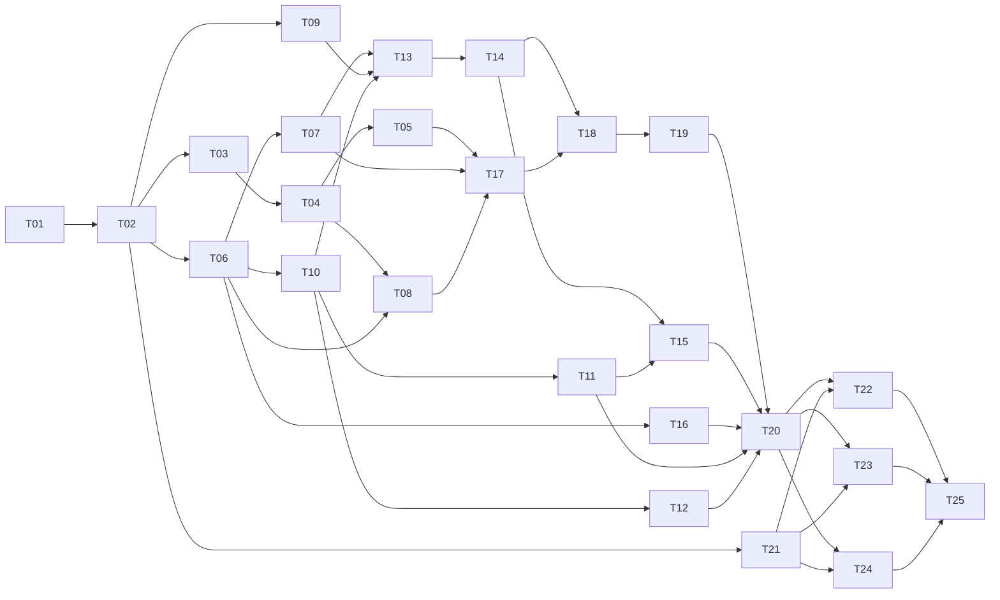

# Phase 1: Foundation

## Deliverable

Play Brinemoor as a freeform conversation with a model acting as GM, on Windows and
macOS, with a local or cloud model, from a desktop browser or a phone on the LAN.

Concretely, at the end of this phase the owner can:

1. Start the server on either OS with `pnpm start` and open it from a phone.
2. Configure an Ollama, OpenAI-compatible, or Anthropic model in Settings, probe it,
   and assign it to the narrator role.
3. Create a campaign from the reference pack's *Arrival* scenario with Wren.
4. Read the streamed opening narration, type actions, and read streamed replies that
   remember the conversation so far. Stop a reply mid-stream.
5. Open the inspector for any turn and read exactly what was sent and received.
6. Lock LAN access with a PIN.

There are no rolls, rulings, memory, edits, or branches yet. The narrator decides
outcomes from the fiction.

## Scope

Each document's phase table is authoritative. In short:

| Area | In phase 1 | Later |
|---|---|---|
| Turns (06 §11) | Turn zero and linear input → narration turns on branch `Main`; cancel and retry | Edits, versions, branches (2); adjudication and resolution (3); extraction (4) |
| Content (04) | Library and pack loading with full validation; campaign creation with the premade PC; setup set | Player-created PCs and stat conversion (SCH-114, SCH-115) with the wizard (8) |
| State | World-state fold for the commit types setup writes | Every other reducer, in the phase that first writes it |
| Context (09 §11) | Templates, layers, locked content, tiers, budgets; narrator recipe with scene and a chunk-rolling transcript; records | Summaries (2); adjudicator (3); knowledge (4) |
| Providers (05) | All three text adapters, mock, queue, structured pipeline, streaming, records, probe, health | Media profiles (9, 10) |
| Content settings (13) | Hard floor in every prompt; settings rendered from the tone profile; automatic tightening when a minor is present | Explicit routing (3); settings UI (8) |
| UI (14 §15) | House theme; library with a minimal new-campaign form; play screen with streaming and Stop; settings with probe and PIN; inspector Prompt and Output tabs | Everything else |
| Reserved (ARCH §8) | Asset tables, job priorities and devices, `media` and `voice` fields | Their features |

Out of scope even if it seems small: OOC input (needs adjudication), any editing of
past turns, journal, dice, themes other than `theme.house`, import and export.

## Tasks

| Task | Title | Depends on |
|---|---|---|
| [P1-T01](../tasks/P1-T01-scaffold.md) | Scaffold the repository and tooling | — |
| [P1-T02](../tasks/P1-T02-contracts-and-fixtures.md) | Install contracts and fixtures; add the spec check | T01 |
| [P1-T03](../tasks/P1-T03-core-foundations.md) | Port core: compare, calendar, theme | T02 |
| [P1-T04](../tasks/P1-T04-core-content-gear-context.md) | Port core: hard floor, ruleset and gear checks, names, budgets | T03 |
| [P1-T05](../tasks/P1-T05-world-state-fold.md) | World-state fold and commit validation | T04 |
| [P1-T06](../tasks/P1-T06-config-module.md) | Server config module | T02 |
| [P1-T07](../tasks/P1-T07-storage-module.md) | Server storage module | T06 |
| [P1-T08](../tasks/P1-T08-content-module.md) | Server content module: packs and libraries | T04, T06 |
| [P1-T09](../tasks/P1-T09-events-module.md) | Server events module: SSE bus and replay | T02 |
| [P1-T10](../tasks/P1-T10-provider-types-and-mock.md) | Provider types, mock adapter, token estimation | T06 |
| [P1-T11](../tasks/P1-T11-local-text-adapters.md) | Ollama and OpenAI-compatible adapters | T10 |
| [P1-T12](../tasks/P1-T12-anthropic-adapter.md) | Anthropic adapter | T10 |
| [P1-T13](../tasks/P1-T13-job-queue.md) | Job queue | T07, T09, T10 |
| [P1-T14](../tasks/P1-T14-structured-pipeline.md) | Structured-output pipeline, streaming, call records | T13 |
| [P1-T15](../tasks/P1-T15-probe-and-health.md) | Probe and provider health | T11, T14 |
| [P1-T16](../tasks/P1-T16-auth-module.md) | Auth module: PIN and sessions | T06 |
| [P1-T17](../tasks/P1-T17-campaign-creation.md) | Campaign creation and the setup set | T05, T07, T08 |
| [P1-T18](../tasks/P1-T18-context-module.md) | Context module and narrator templates | T14, T17 |
| [P1-T19](../tasks/P1-T19-turn-module.md) | Turn module: linear turns | T18 |
| [P1-T20](../tasks/P1-T20-http-and-composition.md) | HTTP routes and the composition root | T11, T12, T15, T16, T19 |
| [P1-T21](../tasks/P1-T21-client-foundation.md) | Client foundation | T02 |
| [P1-T22](../tasks/P1-T22-client-library.md) | Client: library and new campaign | T20, T21 |
| [P1-T23](../tasks/P1-T23-client-play-and-inspector.md) | Client: play screen and inspector | T20, T21 |
| [P1-T24](../tasks/P1-T24-client-settings.md) | Client: settings and PIN screens | T20, T21 |
| [P1-T25](../tasks/P1-T25-phase-acceptance.md) | Phase acceptance: end-to-end tests and README | all |

Tasks on separate branches of the graph can run in parallel, each in its own worktree.
The client foundation (T21) can start as soon as the contracts are installed.

## Working through a task

1. Read the task file and the sections under **Read**, check on `main` that every
   task under **Depends on** has Status `Done` (`pnpm trace` in the main checkout lists
   the tasks ready to start), and agree the approach with the owner before editing.
2. Build on the task's branch. Calls made along the way are **Rulings**; anything that
   changes behavior, scope, or a recorded decision is a **Pending decision**
   (CONV-132, CONV-133).
3. Finish with `/docs land`: the definition of done (CONV-134), the closing sections
   of the documents the task touched (OVR-035), the completion notes, and Status
   `Done`.
4. Before the merge, rebase the branch onto `main` and run `pnpm check` again: two
   branches can take the same new requirement number, or both add to a document's
   closing sections. The owner reviews and merges; then `/status` on `main` updates
   `.claude/status.md`.

## Phase acceptance

Phase 1 is done when P1-T25 is complete (CI green on Windows and macOS, end-to-end
tests included) and the owner has signed off the checks below on both machines
(CONV-139).

**Sign-off checks** (CONV-138). Each names the deliverable item it checks.

- **S1. Install from the README** (deliverable 1). Try: on a fresh clone, follow only
  the README, then run `pnpm start`. Expect: the server runs.
- **S2. First start** (deliverable 2). Try: start Mythos for the first time. Expect: it
  writes the default config and opens Settings.
- **S3. Local and cloud models** (deliverable 2). Try: add a local model (Ollama),
  probe it, and assign it to the narrator, then do the same with one cloud model.
  Expect: each probes and becomes the narrator.
- **S4. Play *Arrival*** (deliverables 3 and 4). Try: create a campaign from *Arrival*
  and play ten turns. Expect: the opening streams, and Wren never learns a name she
  wasn't told (the innkeeper stays "the innkeeper").
- **S5. Stop a reply** (deliverable 4). Try: press Stop while a reply streams. Expect:
  the partial text stays.
- **S6. The inspector** (deliverable 5). Try: open the inspector on a turn. Expect: the
  prompt's tiers and the raw output are there.
- **S7. Play from a phone** (deliverable 1). Try: open the app from a phone on the LAN
  and play a turn. Expect: the turn plays.
- **S8. PIN** (deliverable 6). Try: set a PIN, then open the app from the phone and from
  localhost. Expect: the phone must log in, and localhost doesn't when it is exempt
  (ARCH-111).
- **S9. Restart during a reply** (deliverable 4). Try: restart the server while a reply
  streams. Expect: the turn shows as failed, and Retry finishes it.

**Sign-off** (CONV-139), filled in at phase close. A cell holds `pass, <commit>`,
`fail: <what happened> (#N, P1)`, or `skip`. An empty cell has not been run.

| Check | macOS | Windows |
|---|---|---|
| S1. Install from the README | | |
| S2. First start | | |
| S3. Local and cloud models | | |
| S4. Play *Arrival* | | |
| S5. Stop a reply | | |
| S6. The inspector | | |
| S7. Play from a phone | | |
| S8. PIN | | |
| S9. Restart during a reply | | |

A failed check becomes a bug (CONV-140). Anything else noticed while testing is filed
with `/sign-off-notes` from a second window, and listed below under **Found while
testing** (CONV-141).

## Risks

| Risk | Mitigation |
|---|---|
| `node:sqlite` behaves differently on Windows | Storage tests run in CI on Windows; the driver sits behind one wrapper (ADR-012) |
| Structured output varies by local model | The probe (T15) and the prompt-only fallback (PRV-053) |
| Small models ignore long instructions | Model-profile template layers (CTX-004) let a profile get blunter templates without code |
| A task invents an API, or content the spec doesn't define | Routes not in the spec do not exist (CON-110); the reference pack is a fixture |

## Retrospective

Written with `/docs close` when the phase ends, from the tasks' completion notes and
`git log --oneline -- spec/`. It covers what differed from this plan and why, the spec
amendments the phase made, the rulings later phases should know about, and the work it
deferred. It is a look back, not a progress record: `pnpm trace` and
`.claude/status.md` cover progress.
